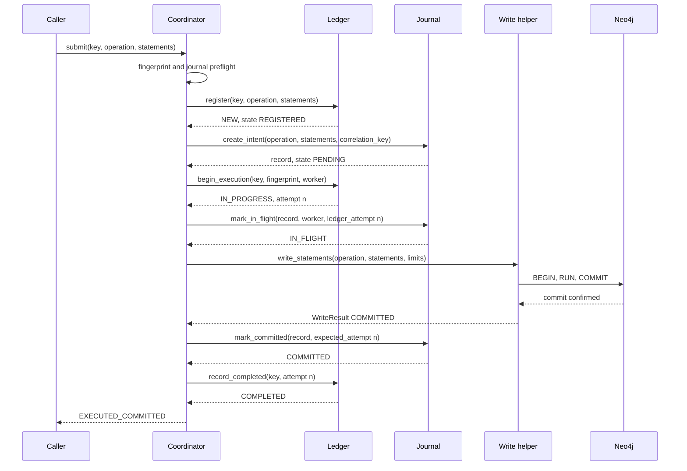
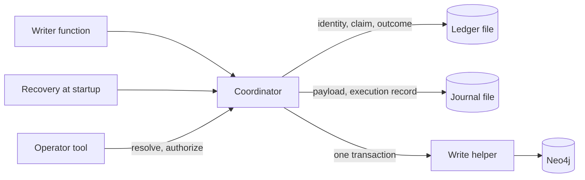
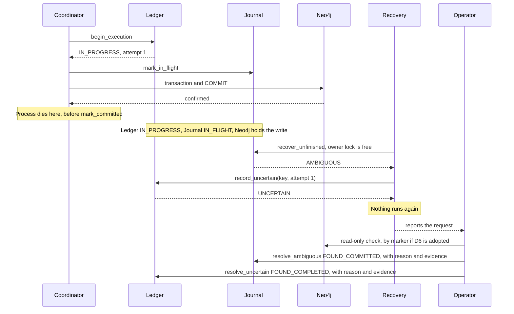
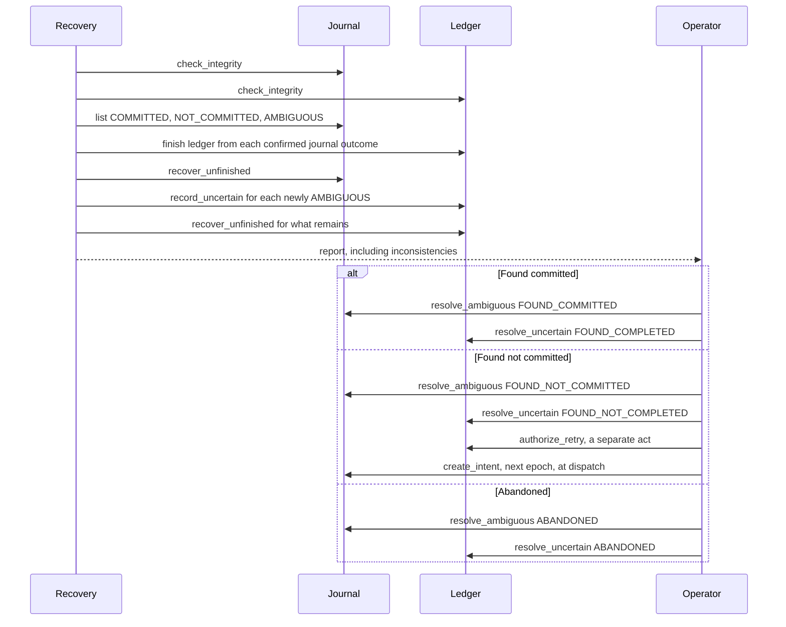
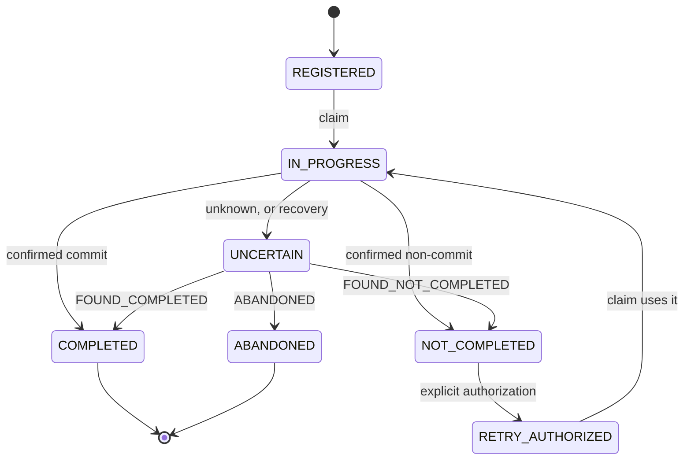

# Journal and ledger coordination contract

Phase 2.5, design only. **Nothing here is implemented.** Everything in this document is **[P] proposed** unless labelled otherwise. Backend paths are relative to `isfcr/CYUKTI/backend/`.

**Labels:** **[V]** verified current behaviour, **[P]** proposed behaviour, **[D]** open decision, **[A]** assumption requiring verification, **[L]** known limitation. `AC-n` means a required API change, listed in `COORDINATOR_INTERFACE_PROPOSAL.md`.

## What this guarantees, and what it doesn't

**It aims to guarantee:**
- Nothing runs without a durable identity and a durable payload.
- One claim wins for each permitted attempt, across threads and processes on one host.
- Nothing whose outcome is unknown runs again without two explicit, audited acts.
- A failure can only leave a request less runnable.

**It doesn't guarantee:**
- **Exactly-once execution.** SQLite and Neo4j can't commit together, so a crash after commit leaves the outcome unknown.
- **Delivery of every alert.** An alert lost before `register` leaves no record (D10).
- **Atomicity of `process_alert`.** Each step remains its own request.
- **Protection across hosts or across separate ledger files.**

## Ownership

| Component | Responsible for | Must not |
|---|---|---|
| **Caller** (a writer function) | Stating the logical operation, its source identity and its payload | Build keys by hand, retry on its own, or treat a timeout as a failure |
| **Coordinator** | Enforcing the order across components, and reconciling them | Hold durable state of its own, or decide what committed in Neo4j |
| **Ledger** | Identity, payload match, attempts, and whether a request may run | Hold payloads, or claim anything about Neo4j |
| **Journal** | The exact payload, and a record of each execution and what it reported | Decide whether anything may run |
| **Write helper** | Running one transaction, and classifying its outcome | Know about keys, the journal or the ledger |
| **Neo4j** | Applying the transaction | |
| **Recovery process** | Finding unfinished work and reconciling records | Run anything, or infer a commit from a missing record |
| **Human operator** | Resolving uncertainty and authorizing retries | Be bypassed for anything that may have executed |

### Authority: one answer to each question

| Question | Authority | Not this |
|---|---|---|
| Does this request exist, and is the payload the same? | **Ledger** | |
| May this request run now? | **Ledger**, through `begin_execution` | Journal state, a caller's belief |
| What exactly should be sent? | **Journal** | The caller, on a retry |
| What did the last attempt report? | **Journal**, then mirrored to the ledger | |
| Is the data actually in the graph? | **Neo4j only,** by a query | Journal or ledger state |
| Was an uncertain outcome really committed? | **A named person,** using evidence | Any inference from an absent record |

When the two records disagree, [Failure analysis](FAILURE_WINDOW_AND_RECOVERY_ANALYSIS.md) lists what each combination means. The rule is that **disagreement is never resolved towards running.**

## The ordering rule

**Close the gate first. Open it last.**

Every multi-store step is ordered so that a crash between the two writes leaves the request less runnable than either record alone suggests.

| Step | First | Then | Why |
|---|---|---|---|
| Register | Ledger | Journal | The identity check runs before anything is stored, so a conflicting payload never creates an intent |
| Start | Ledger claim | Journal `IN_FLIGHT` | Only one caller wins. The loser never touches the journal |
| Execute | Both recorded | Helper | Nothing runs unless both stores know it might |
| Outcome | Journal | Ledger | A confirmed outcome survives even if the ledger write fails, and recovery can finish the ledger from it. The reverse order could say `COMPLETED` with a journal that recovery then marks `AMBIGUOUS` |
| Resolve | Journal | Ledger | The ledger is what permits a re-run, so it opens last |
| Authorize retry | Ledger only | | The journal moves when the retry dispatches |

## Mapping

### Request to intent

| Relationship | Rule |
|---|---|
| Logical request to ledger key | **Exactly one** |
| Logical request to journal intent | **One normally, more only after a resolution** |
| Attempt to ledger | One `attempt_count` value, from `begin_execution` |
| Attempt to journal | One `IN_FLIGHT` period, tagged with that ledger attempt (AC-1) |
| Attempt to helper | One `write_*` call. `WriteResult.attempts` counts driver tries inside it, and it's a separate number |
| Outcome | One journal transition and one ledger transition, correlated by key and attempt |

### When a journal intent is reused, and when it isn't

| Situation | Journal record | Why |
|---|---|---|
| First attempt | New, epoch 1 | |
| Retry after `NOT_COMMITTED` | **Reused** | [V] `authorize_retry` moves it back to `IN_FLIGHT` and keeps the history (`neo4j_write_journal.py:NeoWriteJournal.authorize_retry` L946-951) |
| Retry after `AMBIGUOUS`, resolved `FOUND_NOT_COMMITTED` | **New, next epoch** | [V] `RESOLVED` is final, and the journal's own contract says to create a new intent (`neo4j_write_journal.py:NeoWriteJournal.resolve_ambiguous` L953-958) |

The new intent's statements come from the previous record, and the coordinator checks they still produce the ledger's fingerprint before creating it. That's decision D4.

### Attempt numbers

- [V] The ledger counts on `begin_execution`, and the journal counts on `IN_FLIGHT`.
- They stay equal for one journal record, unless a claim was made and never dispatched. That leaves the ledger ahead.
- **After a new epoch they differ,** because a new journal record starts at 1.
- **So the ledger's number is the only attempt number that means anything across the request.** The journal stores it for each `IN_FLIGHT` (AC-1), and nothing compares raw journal and ledger counts.

## Normal lifecycle

## Components

## Crash after commit

The case no local store can close.

## Recovery and manual reconciliation

## Combined state

The coordinator reports one state, derived from both records. **It's computed, and it's never stored,** so it can't become a second source of truth.

[V] These match the ledger's table exactly (`neo4j_idempotency_ledger.py` L142-152).

## Retry and recovery policy

1. **[P] No automatic replay of anything `AMBIGUOUS` or `UNCERTAIN`.** [V] Neither state machine has such a path.
2. **[P] No retry without explicit authorization when prior execution may have occurred.** Running again after uncertainty takes two acts: resolve, then authorize.
3. **[P] No automatic retry of `NOT_COMMITTED` at first either** (D5). [V] The helper's driver-level retries before COMMIT are unaffected, because they're inside one attempt and can't have committed.
4. **[P] Every retry uses the same key and a new attempt number.** [V] The ledger enforces this.
5. **[P] A retry sends the journal's stored payload,** after checking it against the ledger's fingerprint. A caller can't substitute anything.
6. **[V] A changed payload can't reuse a key.** It's a conflict.
7. **[P] Stale outcomes can't overwrite newer state.** [V] The ledger fences by attempt. [P] The journal doesn't yet, so the coordinator checks first, and AC-3 closes the gap.
8. **[P] Recovery never infers a commit from a missing record.** Journal `COMMITTED` is evidence, because the helper's confirmation produced it. A missing `COMMITTED` isn't evidence of anything.
9. **[P] Human resolution records principal, reason, evidence and decision.** [V] Both stores keep principal, reason and decision in append-only history. [P] Evidence goes in the reason as a reference, unless AC-4 adds a field.
10. **[P] A caller's timeout concludes nothing.** The request stays `IN_PROGRESS` and `IN_FLIGHT`, and a claim by anyone else is refused.

### Semantic gaps the coordinator has to guard

| Gap | Risk | Safeguard |
|---|---|---|
| Journal has no attempt fence | A stale worker writes first to the journal | Check the ledger's attempt before the journal write; AC-3 makes it atomic |
| `authorize_retry` means different things | Calling the journal's would mark `IN_FLIGHT` before any claim | The operator-facing call touches only the ledger. The journal moves at dispatch |
| Journal `mark_not_committed` is allowed from `PENDING`, and the ledger has no equivalent from `REGISTERED` | A write to the journal alone leaves them disagreeing | The coordinator never calls it from `PENDING`. A request that never ran stays `REGISTERED` and `PENDING`, or uses AC-5 |
| `RESOLVED` is final, while `NOT_COMPLETED` can retry | A retry can't reuse the record | New epoch |
| Journal refuses types the ledger accepts | A stranded `REGISTERED` request | Preflight before `register` (AC-2) |
| Ledger `begin_execution` is the only fingerprint check | A wrong payload on dispatch | Check the journal's statements against the ledger's fingerprint before dispatch |
| Separate session locks | One store could be judged dead and not the other | The coordinator opens and closes both together in one process |

## Concurrency and locking

- [V] Each store is thread-safe, and SQLite orders writers across processes with `BEGIN IMMEDIATE`.
- [V] Exactly one claim wins, by test across processes (Phase 2.4).
- [P] The coordinator holds **no lock across stores,** and **none across a Neo4j call.** A slow transaction must never block other requests. The ordering rule makes that safe.
- [P] Keys aren't serialized against each other. Campaign-level ordering is unchanged by this design and still comes from the one queue worker.
- [P] Recovery runs before workers start. It can also run while workers are live, because both stores leave live owners' records alone.
- [L] Three threads call writers today (queue, maintenance, flush). They use different keys, and claims stay safe.

## Persistence, backup, retention and integrity

- [P] Two files in one explicit, local, non-network directory, configured once. WSL's `/mnt/c` isn't acceptable.
- [V] Both refuse foreign or damaged files without changing them, and both are 0600.
- [L] **The journal holds parameters in plaintext.** It needs the same protection as the graph data.
- [P] **Backup:** the two files can't be captured atomically. Use SQLite's backup API, journal first, then ledger. A restored pair may disagree, and recovery handles that the same way as a crash.
- [P] **A restored backup can make an old state runnable.** After any restore, the operator must treat requests since the backup as uncertain. There's no automatic protection against this.
- [P] **Retention:** nothing is deleted (D12). [V] Triggers enforce it.
- [P] **Integrity:** recovery runs both checks first, and damaged records are excluded and reported, never repaired.
