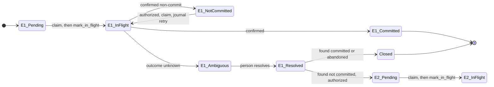

# D4: retry after resolution

Phase 2.6A, design only. **Nothing here is implemented.** Backend paths are relative to `isfcr/CYUKTI/backend/`.

**Labels:** **[V]** verified current behaviour, **[M]** measured evidence, **[P]** proposed behaviour, **[A]** assumption, **[D]** open decision, **[R]** requires production validation.

## Verdict

**The new-intent approach holds, and every window checked ends in a state that can't run without a new authorization.** It needs three small additions to Phase 2.5, listed under "Windows".

[V] It rests on these facts:

- `RESOLVED` is final: `neo4j_write_journal.py:NeoWriteJournal.resolve_ambiguous` L953-958.
- The ledger's `FOUND_NOT_COMPLETED` returns to `NOT_COMPLETED`: `neo4j_idempotency_ledger.py:IdempotencyLedger.resolve_uncertain` L1132-1138.
- The ledger's authorization only grants: `neo4j_idempotency_ledger.py:IdempotencyLedger.authorize_retry` L1125-1130.

## State sequence

`J` is the journal, `L` the ledger. `e` is the epoch and `a` the ledger attempt. All steps are [P], using the existing states.

| Step | Action | J (epoch) | L | Attempt |
|---|---|---|---|---|
| 1 | **First execution.** Register | none | `REGISTERED` | 0 |
| 2 | Create intent, e1 | `PENDING` | `REGISTERED` | 0 |
| 3 | Claim | `PENDING` | `IN_PROGRESS` | a1 |
| 4 | `mark_in_flight(a1)`, then the helper runs | `IN_FLIGHT` | `IN_PROGRESS` | a1 |

**Path A, confirmed non-commit.** The record lives on, with no new epoch:

| Step | Action | J (e1) | L | Attempt |
|---|---|---|---|---|
| 5a | Helper: `NOT_COMMITTED`. Journal first | `NOT_COMMITTED` | `IN_PROGRESS` | a1 |
| 6a | Then the ledger | `NOT_COMMITTED` | `NOT_COMPLETED` | a1 |
| 7a | Explicit `authorize_retry` (ledger only) | `NOT_COMMITTED` | `RETRY_AUTHORIZED` | a1 |
| 8a | Claim | `NOT_COMMITTED` | `IN_PROGRESS` | a2 |
| 9a | Journal `authorize_retry(a2)`, then the helper | `IN_FLIGHT` | `IN_PROGRESS` | a2 |

**Path B, ambiguous.** The record ends, and a new one starts:

| Step | Action | J | L | Attempt |
|---|---|---|---|---|
| 5b | Helper: `AMBIGUOUS` | e1 `AMBIGUOUS` | `IN_PROGRESS` | a1 |
| 6b | Then the ledger | e1 `AMBIGUOUS` | `UNCERTAIN` | a1 |
| 7b | **Manual resolution,** non-commit, journal first | e1 `RESOLVED` | `UNCERTAIN` | a1 |
| 8b | Then the ledger | e1 `RESOLVED` | `NOT_COMPLETED` | a1 |
| 9b | **Explicit authorization** | e1 `RESOLVED` | `RETRY_AUTHORIZED` | a1 |
| 10b | **New intent,** e2, from e1's stored statements | e1 `RESOLVED`, e2 `PENDING` | `RETRY_AUTHORIZED` | a1 |
| 11b | **Subsequent attempt,** claim | e2 `PENDING` | `IN_PROGRESS` | a2 |
| 12b | `mark_in_flight(a2)`, then the helper | e2 `IN_FLIGHT` | `IN_PROGRESS` | a2 |

## The ten questions

| # | Question | Answer | Label |
|---|---|---|---|
| 1 | Resolved committed | J `RESOLVED` (`FOUND_COMMITTED`), L `COMPLETED`. No new intent, ever. The store refuses a next epoch | [P] |
| 2 | Resolved not committed | J `RESOLVED` (`FOUND_NOT_COMMITTED`), L `NOT_COMPLETED`. **Nothing runs,** and it needs authorization | [V] states, [P] mapping |
| 3 | Ledger authorizes the next attempt | `authorize_retry`, from `NOT_COMPLETED` to `RETRY_AUTHORIZED`, with a required principal and reason. It grants one attempt | [V] |
| 4 | How the new intent links | Same `correlation_key`, epoch + 1, identical `intent_sha256` and `operation`, all checked by the store in one transaction (AC-1). It's built from the old record's stored statements, never by a caller | [P] |
| 5 | Is the old record retained? | **Yes, unchanged.** It's append-only by trigger, and `RESOLVED` is final. `find_by_correlation_key` returns every epoch | [V] append-only, [P] lookup |
| 6 | Attempt ordering | The ledger's attempt only rises, across epochs. `attempt_count` restarts per record. The order of events is `(epoch, ledger_attempt)`. Gaps are normal | [V], [P] |
| 7 | Duplicate authorization | **Rejected.** The ledger allows it only from `NOT_COMPLETED`, so a second call raises `InvalidTransitionError` with no change | [V] |
| 8 | New intent succeeds, ledger update fails | J e2 `PENDING`, L `RETRY_AUTHORIZED`. Nothing ran. The next `retry` finds e2 and reuses it. Row 3 below | [P] |
| 9 | Authorization succeeds, intent creation fails | L `RETRY_AUTHORIZED`, latest J e1 `RESOLVED`. Nothing ran. The next `retry` creates e2. Row 2 below | [P] |
| 10 | Crash recovery between them | Table below. **Every state is either safe to continue or blocked** | [P] |

## Crash windows

| # | Crash after | J | L | Can it run? | Recovery |
|---|---|---|---|---|---|
| 1 | Journal resolved, ledger not | e1 `RESOLVED` | `UNCERTAIN` | No | Repeat the resolve with the same decision. A different one raises `ResolutionConflict`. `recover` reports it |
| 2 | Authorization | e1 `RESOLVED` | `RETRY_AUTHORIZED` | One attempt, by an explicit `retry` | `retry` creates e2 |
| 3 | New intent | e2 `PENDING` | `RETRY_AUTHORIZED` | One attempt, by `retry` | `retry` reuses e2 by unique lookup |
| 4 | Claim, before `IN_FLIGHT` | e2 `PENDING` | `IN_PROGRESS` a2 | No | In-process: `record_not_completed`. After a crash: `UNCERTAIN`, `CLAIMED_NOT_DISPATCHED`. Resolve in the ledger only |
| 5 | Claim, before journal retry on Path A | e1 `NOT_COMMITTED`, row attempt a1 | `IN_PROGRESS` a2 | No | **New, see below.** The same handling as row 4 |
| 6 | `IN_FLIGHT`, before the helper finishes | e2 `IN_FLIGHT` | `IN_PROGRESS` a2 | No | Recovery: `AMBIGUOUS` and `UNCERTAIN`. It may or may not have run |
| 7 | Outcome in the journal, not the ledger | e2 outcome | `IN_PROGRESS` a2 | No | Recovery copies the journal's outcome to the ledger, as Phase 2.5 says |

Concurrent dispatchers on rows 2 and 3: the `UNIQUE(correlation_key, epoch)` loser re-reads, and one claim wins. The other gets `IN_PROGRESS_ELSEWHERE`. **No window lets two helpers run.**

## Windows and required changes

### 1. Two combinations Phase 2.5 didn't list

**[V] Correction to Phase 2.5.** Its tables omit two legal results of a failed step:

| State | How | Rule |
|---|---|---|
| L `NOT_COMPLETED`, J `PENDING` | Claim succeeded, `mark_in_flight` failed, in-process `record_not_completed` | [P] Consistent. On authorization, the next claim uses `mark_in_flight` on the same epoch |
| L `IN_PROGRESS` or `UNCERTAIN`, J `NOT_COMMITTED` with a lower attempt | Row 5 | [P] Consistent. **The lower attempt proves the helper didn't run for this claim,** because `IN_FLIGHT` precedes it. So it's `CLAIMED_NOT_DISPATCHED`, and the ledger alone resolves |

**Minimum change:** add both to the coordinator's consistency table. AC-1's `ledger_attempt` makes the second provable, and there's no new state.

### 2. A retry after an authorized state with the wrong record

| State | Rule |
|---|---|
| L `RETRY_AUTHORIZED`, latest J `RESOLVED` with `FOUND_COMMITTED` or `ABANDONED` | [P] `CoordinationInconsistency`, and it stops. The store's epoch rule also refuses it |

**Minimum change:** one rule, and AC-1 enforces it.

### 3. A person's "not committed" can be wrong

[V] For an additive write, nothing in the graph tells a person whether it committed. **The state machine can't detect that mistake,** and a retry would double-count.

**This is the unhandled risk in D4.** With an applied-write marker the retry fails at the constraint and becomes `ALREADY_APPLIED`. Without a marker, the only safe decision for an additive write is often `ABANDONED`, which accepts a possible undercount. See `D6_APPLIED_WRITE_MARKER_DESIGN.md`.

**Minimum change:** none to the retry model. It's a reason to approve D6.

### 4. Copying the authorizer

[V] The journal's `authorize_retry` requires `authorized_by` and `reason`, while the coordinator's public `retry` takes neither.

**Minimum change:** [P] The coordinator copies them from the ledger's latest `RETRY_AUTHORIZED` event (`neo4j_idempotency_ledger.py:IdempotencyLedger.get_history` L1064-1079). If it can't read them, it stops before dispatch.

## Tests

| Area | Cases |
|---|---|
| Paths | A and B run end to end on real SQLite files with a fake helper |
| Windows | A real child process killed at each of the seven rows, followed by recovery |
| Refusals | Duplicate authorization; epoch after commit or abandon; a substituted payload; two dispatchers |
| Ordering | Attempts rise across epochs, with gaps |
| **Control** | One no-op crash test, so that a broken harness can't pass |

## If rejected

The alternative is letting `RESOLVED` retry, which reverses your Phase 2.3 rule and blurs what the record means.
