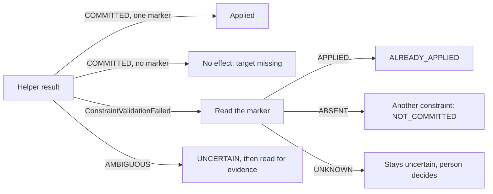

# D6: applied-write marker

Phase 2.6A, design only. **No marker, constraint or schema change exists. No database was started.** Backend paths are relative to `isfcr/CYUKTI/backend/`.

**Labels:** **[V]** verified current behaviour, **[M]** measured evidence, **[P]** proposed behaviour, **[A]** assumption, **[D]** open decision, **[R]** requires production validation, **[L]** known limitation.

## Verdict

- **Feasible on paper, but not yet proven:** three behaviours need a real server.
- **Not mandatory for safety on `update_duplicate_event`,** because the ledger alone refuses a second run.
- **I recommend making it mandatory for the pilot anyway.** Without it, an uncertain additive write has no evidence, so its only safe resolution is to give up the count, and the pilot couldn't test retry at all.
- **This phase found one trap:** a marker written as its own statement can be false. It must share the mutation's `MATCH`.

## Design

```
(:AppliedWrite {request_key, applied_at})
```

| Item | Choice | Why |
|---|---|---|
| Label | `AppliedWrite` | New and used for nothing else |
| Stable key | `request_key`, the ledger key, unchanged | It already identifies one logical request |
| Other properties | `applied_at: datetime()`, set by the server | Diagnostic, and not a parameter, so the fingerprint doesn't change |
| **No `attempt` property** | Corrects this phase's early idea | [V] Parameters are in the fingerprint, so an attempt number would make each retry look like a conflict (`neo4j_idempotency_ledger.py:fingerprint_payload` L320-356) |
| Relationships | **None** | [V] `graph_feature_engine.py` L54-57 matches untyped relationships such as `(a)-[r1]->(c)`, so a linked marker would enter the features |
| Constraint | `CREATE CONSTRAINT applied_write_key IF NOT EXISTS FOR (m:AppliedWrite) REQUIRE m.request_key IS UNIQUE` | Stops a second execution in Neo4j |

### Rejected strategies

| Strategy | Why not |
|---|---|
| Relationship from the entity to a marker | Visible to untyped reads, as above |
| List property on the entity | Unbounded, with no constraint, and every write rewrites it |
| `MERGE` with a conditional mutation | Rewrites every writer's logic, and `MERGE` without a constraint can race |
| Marker as a separate statement | **False evidence, see next** |

## The trap, and the atomic transaction

[V] `update_duplicate_event` starts with `MATCH (e:AttackEvent {event_id:$event_id})` (`neo4j_client.py:update_duplicate_event` L712-748). If no event matches, the query does nothing and returns normally.

A separate `CREATE` marker statement would commit anyway. **The graph would then say "applied" when nothing was.**

[P] So the marker goes inside the same pattern, in one statement:

```cypher
WITH coalesce($event_time, datetime()) AS dt
MATCH (e:AttackEvent {event_id:$event_id})
CREATE (:AppliedWrite {request_key:$request_key, applied_at:datetime()})
SET e.last_seen = CASE WHEN e.last_seen IS NULL OR dt > e.last_seen THEN dt ELSE e.last_seen END,
    e.occurrences = coalesce(e.occurrences,0) + 1,
    e.tps = coalesce(e.tps,0) + $tps,
    e.investigation_payload = $investigation_payload
WITH e, dt
MATCH (e)-[:MATCHES]->(t:Technique)
...the remainder is unchanged...
```

[V] This runs in one transaction through the existing helper (`neo4j_client.py:_execute_write` L289-360). The driver may re-run it before commit, which is safe because nothing has committed. It never re-runs after COMMIT.

### A committed write with no marker

[P] If the event is missing, the transaction commits with `nodes_created == 0`. The helper already reports that counter.

| Helper result | `nodes_created` | Meaning | Coordinator |
|---|---|---|---|
| `COMMITTED` | 1 | Applied, with evidence | Normal |
| `COMMITTED` | 0 | **Target missing: committed, with no effect** | New `COMMITTED_NO_EFFECT`. Journal `COMMITTED`, ledger `COMPLETED`, logged as an error. Retrying can't help |

[D] Treating this as completed records a lost count. Today it's silent, so this makes it visible without changing the result.

## The ten questions

| # | Question | Answer | Label |
|---|---|---|---|
| 1 | Entity updated | One `AttackEvent`, and on the unattributed path only that. See `D13_FIRST_WRITER_SELECTION.md` | [V] |
| 2 | Unique identity | The ledger key, built from the D1 source identity plus operation | [P], [R] |
| 3 | Same-transaction marker? | **Yes,** in the same statement as above | [P]. One transaction: [V] by the helper's code. Atomicity with this statement: **test 1 below** |
| 4 | Does a constraint stop concurrent duplicates? | Expected: the second creator waits for the first, then fails or proceeds. **Not tested with this label** | [A], needs a real server |
| 5 | Retry when a marker exists | `CREATE` fails with `ConstraintValidationFailed`, and **the whole transaction rolls back,** so nothing doubles. The helper reports `NOT_COMMITTED`, attempts 1 (real-server evidence: Phase 2.2.1R #6). The coordinator then reads the marker. **This isn't a normal failure** | [M] the error, [P] the mapping |
| 6 | Commit with a lost reply | Helper `AMBIGUOUS`, journal `AMBIGUOUS`, ledger `UNCERTAIN`. **The marker exists,** because it committed with the write. Reading it gives direct evidence | [P] |
| 7 | Query after restart | **Yes:** AC-8, a read with no writes. Not inside `recover`, which must work with Neo4j down. A separate evidence step, which can answer `UNKNOWN` | [P] |
| 8 | Retention without unbounded growth | **Not solved by deletion alone,** below. For the pilot: keep everything, and measure | [D] |
| 9 | Marker deleted while replayable | **The duplicate gate falls back to the ledger.** If the ledger is intact it still refuses. If both are gone, the write runs again. Deleted evidence can't be told apart from "never applied" | [V] reasoning |
| 10 | Generalizes to Tier 1? | Largely, with a different statement per writer. Table below | [P] |

## Duplicate behaviour



| Step | Contract |
|---|---|
| Error code alone | **Not enough.** `ConstraintValidationFailed` doesn't say which constraint, so the marker must be read |
| `ALREADY_APPLIED` | Journal `NOT_COMMITTED`, which is true of this attempt, with a diagnostic. Ledger `COMPLETED`, which is true of the request |
| New store mismatch | **That pair must be added to the coordinator's consistency table** as valid when a marker exists |
| Crash between them | J `NOT_COMMITTED`, L `IN_PROGRESS`, then `UNCERTAIN` on recovery. Safe: another attempt hits the same constraint |

## What marker results mean

This separates the four cases the brief names.

| Result | Meaning | Allowed conclusion |
|---|---|---|
| **Evidence applied:** the read returns the marker | The mutation committed with it, unless markers were altered by hand | Resolve as committed. A person decides at first |
| **Evidence not applied:** the read returns nothing, **and all conditions below hold** | Very likely never applied | A person may resolve as not committed, then authorize |
| **Absence of a marker, conditions not shown** | **Unknown.** The transaction may still be open, or the store may have been restored | **No conclusion.** Stays uncertain |
| **Ambiguous query result:** timeout, connection failure, or error | Nothing was learned | **No conclusion.** Stays uncertain. Never read as absent |

### When absence can count as evidence

**Absence isn't proof by itself.** [P] All of these must hold:

| # | Condition | Basis |
|---|---|---|
| 1 | The owning process is dead | [V] Liveness flock, `neo4j_write_journal.py:NeoWriteJournal.recover_unfinished` L960-1023 |
| 2 | Longer than the 8 s transaction timeout, plus a margin, has passed since dispatch | [M] Late COMMITs after timeout were rejected with 0 on the server in 7 of 7 tries (B7, B8). **Your ruling applies:** a COMMIT rejected with `TransactionTimedOutClientConfiguration` stays `AMBIGUOUS` until separately evidenced |
| 3 | No matching transaction is open | **[A] Unverified.** The helper sets no metadata, so this can't be matched by request today (AC-9). With only one worker, "no write transaction is open" may serve. Needs a real-server check |
| 4 | Same store as at dispatch: no restore or rebuild since | [P] Compare a database identifier recorded at dispatch. After a restore, the marker and the mutation can vanish together, while the ledger still says `COMPLETED` |
| 5 | The read was on an authoritative server | [A] Single-instance assumption. [R] A cluster needs bookmarks or a leader read |
| 6 | The constraint exists | [P] A missing constraint means markers aren't trustworthy |

[P] **Absence never resolves automatically in this design.** A person decides, the conditions are recorded in the reason, and the constraint remains as a backstop if they were wrong.

## Retention

[M] W07U at the sample's rate: **11,197 requests a day, so 11,197 markers a day.** The busiest second is 377.

[A] **Storage per marker is unmeasured.** A rough guess of 0.3 to 0.6 KB, including its index entry, gives about 3 to 7 MB a day for W07U alone. Measure this before relying on it. Every Tier 1 writer would add more.

| Option | Effect | Recommendation |
|---|---|---|
| Keep everything | Grows without limit, but simple and always correct | **Pilot only** |
| Delete when the ledger shows a terminal state and it's older than the longest re-delivery horizon | Bounded. **Removes the second line of defence** and reconciliation evidence for old requests. Replaying an archive into the same graph relies on the ledger alone | Likely long-term answer. **[D]** |
| Delete on a fixed age, regardless of state | Could remove evidence of an open request | **Rejected** |

Any deletion is a new maintenance writer, with its own design and approval. Horizon and growth need production-shaped data.

## Schema and migration

| Item | Detail |
|---|---|
| Change | One new label and one uniqueness constraint. No existing node or relationship changes |
| [V] Today | No production code creates constraints or indexes |
| How | An operator step, run once **before** enabling. A schema change can't share a transaction with data |
| Startup check | [P] The coordinator checks `SHOW CONSTRAINTS` and refuses marker mode if it's absent |
| Edition | [M] Uniqueness constraints worked on the disposable 5.26.27 Community server (`exp_uid`). **[R] The production edition and version weren't queried,** because connecting to `neo4j-soc` is out of bounds |
| Query text | Adding a marker changes query text, and so the fingerprint. Open requests must drain first, by design |
| Rollback | Stop marker mode, then `DROP CONSTRAINT`. Markers are inert and can stay. A rollback also ends server-side duplicate protection |
| Backups | Markers are in graph backups, hence condition 4 |

### Visibility to existing queries

[M] `evidence/d6_d13_static_scan_output.txt` scanned backend Python strings for a node with no label and no relationship. It found 5 hits in `dashboard_api.py`, and none can reach a marker: two start from `elementId($node_id)`, and three are the phrase `labels(n)` on nodes already collected from typed patterns. No `db.labels`, `db.schema` or `apoc.meta` use.

**[L] Limits:** a text scan of `backend/` only, so `research/` scripts weren't covered. Free-form read queries in the dashboard (`dashboard_api.py` L932-997) could show markers if someone asks for all nodes. Dashboards and Neo4j Browser totals would count them.

## Performance and storage risks

| Risk | Level | Note |
|---|---|---|
| Growth | Real | Above |
| Write cost | Unknown | One more node and index entry per write. **Measure,** on the busiest path |
| Lock contention | Expected low | Keys are distinct unless it's a true duplicate, and the marker comes first |
| A duplicate blocking until the first finishes | Bounded | The 8 s transaction timeout applies, then a normal `NOT_COMMITTED` |
| Deadlock | Expected low | Marker before other locks. **Test** |

## Generalizing to Tier 1

| Writer | Marker position | Note |
|---|---|---|
| W07 attributed | As above | Inside the first `MATCH` |
| W06, W05 | With the `MATCH (c:Campaign)` | Needs D7 ids. Two protections, if the id is constrained too |
| W01, W16 | With the `CREATE` | Needs D7 |
| W10 | First statement, tied to the chain | Two statements become one request, one marker |
| W08 | **One per batch, once D8 picks a batch identity** | Unresolved |

Rule for all: **the marker is created only when the mutation's own pattern matched.** Each writer needs its own zero-match test.

## Evidence required, on an authorized disposable server

| # | Test | Pass |
|---|---|---|
| 1 | Marker and mutation commit together; a failure after `CREATE` leaves neither | Graph checks both ways |
| 2 | Second run with the same key | `ConstraintValidationFailed`, counter unchanged, whole transaction rolled back |
| 3 | Two concurrent runs, repeated many times | Exactly one applies. Measure the waits |
| 4 | Missing event | `nodes_created == 0`, no marker |
| 5 | Lost reply through the existing fault proxy | Helper `AMBIGUOUS`, marker present, count +1, and a retry doesn't double |
| 6 | Kill the server mid-write, then restart | Marker and mutation agree |
| 7 | Read during an open transaction | Absent until commit, so absence alone is shown to be insufficient |
| 8 | `SHOW TRANSACTIONS` on Community | Establishes whether condition 3 is usable |
| 9 | W07U's `MATCHES` stop | Campaign unchanged on an unattributed event |
| 10 | Cost | Latency with and without the marker, and storage per marker |
| 11 | All backend read paths on a graph with markers | Same results as without |

## Is it mandatory before migrating `update_duplicate_event`?

| Question | Answer |
|---|---|
| To prevent a double count while the ledger is intact | **No.** The ledger refuses a second run |
| To resolve an uncertain write with evidence | **Yes.** `occurrences` is additive, and `investigation_payload` is overwritten by later alerts, so the graph has no other answer |
| To safely run a retry after uncertainty | **Yes, effectively.** Otherwise a person's guess can double a count (`D4_RETRY_AFTER_RESOLUTION.md`) |
| To protect against losing the ledger | **Yes.** It's the only other guard |

**Recommendation: mandatory for the W07U pilot.** If you decline the schema change, W07U can still migrate, with uncertainty resolved only as `ABANDONED`. That protects against double counting and accepts some undercount, and it leaves retry-after-uncertainty unvalidated.

## If rejected

Recovery stays correct but manual. Every crash after dispatch needs a person, who has no evidence for additive writes.
