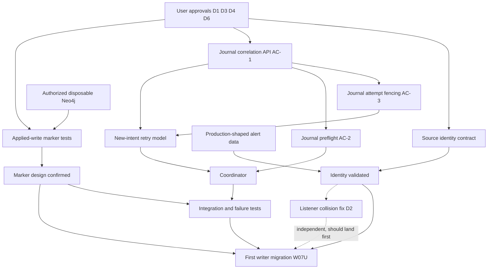

# Phase 2.6 implementation readiness

Phase 2.6A. **Nothing has been implemented, and nothing here starts automatically.**

**Labels:** **[V]** verified current behaviour, **[M]** measured evidence, **[P]** proposed behaviour, **[A]** assumption, **[D]** open decision, **[R]** requires production validation.

## Verdict

**Phase 2.6 isn't ready to implement.** Complete documents aren't readiness. Today:

| Gate | State |
|---|---|
| Approvals | **None given.** All of D1 to D15 are open |
| Wazuh identity outside the sample | **Unvalidated:** no restart, rotation, restore, or second manager has been seen |
| Marker on a real server | **Untested** |
| Stopped-query behaviour for W07U | **Read, not run** |
| Coordinator cost at peak | **Unmeasured** |
| Production Neo4j edition and constraints | **Unknown** |

**What could begin, once you approve it:** journal API work (D3, D4), the listener fix (D1, D2), and marker tests on a disposable server (D6). Each is independent of the others.

**The earlier open item stays open:** 27 unexpected network attempts from 16 tests in 8 files remain untraced. They don't block design, but they should be understood before coordinator tests join the full suite.

## Dependency graph

## What blocks what

### Blocks the coordinator

| Prerequisite | Why | Acceptance evidence |
|---|---|---|
| Approval of D3 and D4 | The coordinator is built on them | Your written approval |
| AC-1 correlation API | Stores can't find each other otherwise | Tests in `D3_JOURNAL_LEDGER_API_CONTRACT.md`, including two real processes and crash children with a no-op control. All existing journal tests still pass, apart from the listed ones updated for schema v2 |
| AC-2 preflight | A refused value would strand a request | Same decisions as `create_intent` over the Phase 2.3 table. Proven to store nothing |
| AC-3 fencing | A stale outcome would reach the journal first | Row and history byte-identical after each refusal |
| New-intent retry model | The ledger can run again after the journal is final | Paths A and B, all seven crash windows in `D4_RETRY_AFTER_RESOLUTION.md` |
| D5, D14, D15 | The coordinator must behave defined in these cases | Your rulings |

### Blocks only specific writers

| Prerequisite | Blocks | Acceptance evidence |
|---|---|---|
| D1 validated identity | **Every writer,** though not the coordinator's own code, which treats keys as strings | The eight checks in `D1_SOURCE_IDENTITY_DECISION.md` |
| Applied-write marker | W07U as recommended. Others as they migrate | The 11 real-server tests in `D6_APPLIED_WRITE_MARKER_DESIGN.md` |
| AC-8 marker read | Same | `APPLIED`, `ABSENT`, `UNKNOWN`, with a failed read never reported as absent |
| D7 derived ids | W01, W05, W06, W16 | Same id across re-delivery. Dashboard unaffected |
| D8 batch identity | W08 | The Phase 2.1 double count no longer reproduces |
| D9 | W19, W20 | Your ruling |
| W07U benchmark | W07U going live | Replayed peak sustained with no unbounded backlog |

### Safely deferred

| Item | Why it's safe | Revisit when |
|---|---|---|
| AC-4 resolve evidence | `reason` holds it | Operators ask |
| AC-5 abandon registered | Harmless | Open requests accumulate |
| AC-9 transaction metadata | Only strengthens absence evidence | Absence is used routinely |
| Marker deletion | Growth is small enough for a pilot | After growth is measured |
| D10 alert-level resume | Existing gap, not worsened | A separate design |
| D12 archive | Growth is measured first | After the pilot |
| Policy-authorized retries (D5b) | A person covers the pilot | Real counts exist |
| Listener offset hardening (N5) | Existing behaviour | With D10 |

### Needs production-shaped data

| Question | Data |
|---|---|
| ID uniqueness across rotation, restart and peak | Copies of `alerts.json`, provided by you |
| Real collision rate | Same, or a count of "Duplicate raw alert ignored" lines |
| Real alert rate and burst | Same |
| Whether `manager.name` is stable | Same, plus deployment facts |
| Real marker and store growth | A pilot period or a realistic replay |

### Needs an authorized Neo4j test environment

| Question | Test |
|---|---|
| Marker atomicity, constraint races, lost reply | `D6_APPLIED_WRITE_MARKER_DESIGN.md`, tests 1 to 6 |
| Absence evidence | Tests 7, 8 |
| W07U stopping before the Campaign | Test 9 |
| Marker cost and read paths | Tests 10, 11 |
| Coordinator integration and failure | Phase 2.5 plan, on the real server through the existing fault proxy |

These use a disposable instance through `neo4j_up.sh` on Docker Desktop. **Never `neo4j-soc`.**

### Needs the production server, separately

| Question | Authorization |
|---|---|
| Edition, version, existing constraints | A read-only query, or a statement from you |
| Creating the constraint | A separate approval. It's a production schema change |

## Proposed order, for your approval

Each step stops for your review.

| Step | Work | Needs |
|---|---|---|
| 1 | Listener collision fix | D1 identity rule, D2 |
| 2 | AC-1, AC-2, AC-3 | D3, D4 |
| 3 | Real-server marker and stopped-query tests | D6 test scope |
| 4 | Coordinator with fakes, then a real server | D5, D14, D15, step 2 |
| 5 | Identity validation on your data | Data from you |
| 6 | W07U benchmark | Steps 3, 4 |
| 7 | W07U migration behind a flag, off by default | D1, D6 production, D13, N1 to N3 |

Steps 1 to 3 can run in any order. Step 5 can run at any time, and earlier is better, because a surprise there changes D1.

## Next authorization needed

**A ruling on the decisions in `DECISION_REGISTER_D1_D15.md`.** The smallest useful set is:

1. D3 and D4, to begin journal work.
2. D1 and D2, to fix the alert loss.
3. D6's test scope, with permission to start a disposable server.
4. A copy of production-shaped alerts, whenever available.
