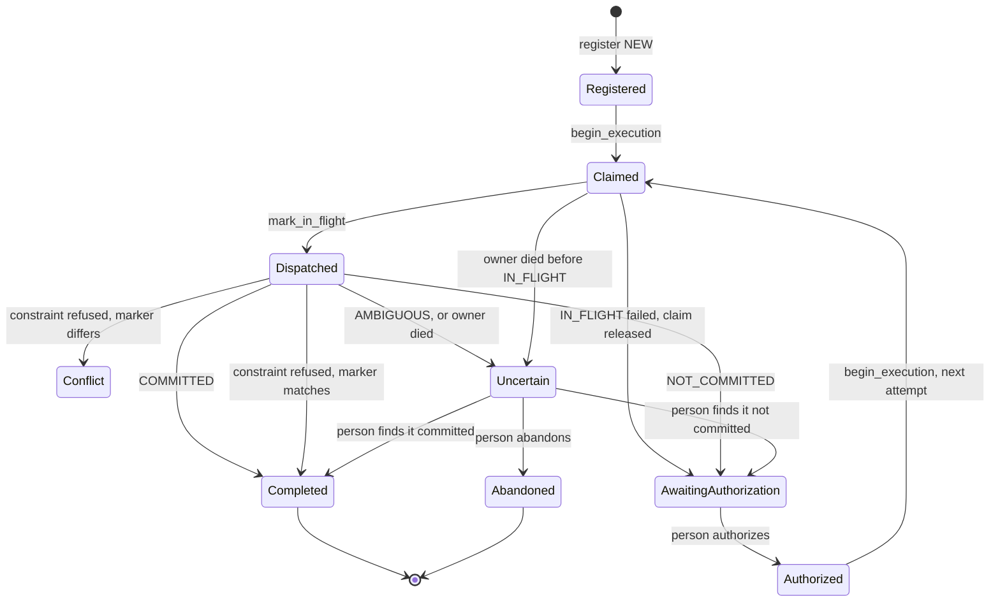

# Coordinator state machine

Planning only. **Nothing here is implemented.** Backend paths are relative to `isfcr/CYUKTI/backend/`. **[F]** fact, **[R]** recommendation, **[U]** unverified.

**No state is stored by the coordinator.** The combined state is computed from the ledger and journal each time, so it can't become a second source of truth.

## Combined states

`L` is the ledger, and `J` is the latest journal epoch.

| Combined state | L | J | Can it run? |
|---|---|---|---|
| Registered | `REGISTERED` | `PENDING` or none | Once claimed |
| Claimed | `IN_PROGRESS` | `PENDING`, or `NOT_COMMITTED` at a lower attempt | Only the claimant |
| Dispatched | `IN_PROGRESS` | `IN_FLIGHT`, same attempt | Already running |
| Completed | `COMPLETED` | `COMMITTED`, `RESOLVED` as found committed, or `NOT_COMMITTED` with marker evidence | **Never** |
| AwaitingAuthorization | `NOT_COMPLETED` | `NOT_COMMITTED`, `PENDING`, or `RESOLVED` as found not committed | Not until authorized |
| Authorized | `RETRY_AUTHORIZED` | The same, or a new `PENDING` epoch | Once claimed |
| Uncertain | `UNCERTAIN` | `AMBIGUOUS`, `PENDING` or lower-attempt `NOT_COMMITTED` | **No** |
| Conflict | `NOT_COMPLETED` | `NOT_COMMITTED`, with conflict recorded in its diagnostic | **No,** by the coordinator's check |
| Abandoned | `ABANDONED` | `RESOLVED` as abandoned, or any | **Never** |

**[F] Conflict and AwaitingAuthorization have no way to be given up.** The ledger reaches `ABANDONED` only from `UNCERTAIN` (`neo4j_idempotency_ledger.py` L142-152). So a conflicted request stays held, visibly and safely, with no terminal state. Closing it needs a small additive ledger transition, `NOT_COMPLETED` to `ABANDONED`, which changes a completed component: **OD-12.** Nothing in this design depends on it for safety.

**Names differ between stores.** [F] The journal's resolutions are `FOUND_COMMITTED` and `FOUND_NOT_COMMITTED`, and the ledger's are `FOUND_COMPLETED` and `FOUND_NOT_COMPLETED`. `resolve(decision)` takes one decision and maps it to both.

**Legal pairs from 2.6A, tested in 2.6B:** L `NOT_COMPLETED` with J `PENDING`, and L `IN_PROGRESS` or `UNCERTAIN` with J `NOT_COMMITTED` at a lower attempt.

**A new legal pair:** L `COMPLETED` with J `NOT_COMMITTED`, **only** when that attempt was refused by the constraint and the marker's fingerprint matched. 2.5's table lists this as impossible, so `check_consistency` needs the exception, and it needs evidence recorded in the journal's diagnostic.

## Failure at every transition

Rule throughout: [F] **a failure leaves a request less runnable, never more.** All store errors are named in 2.5's taxonomy.

| # | Transition | Failure | Durable state left | Caller sees | Recovery |
|---|---|---|---|---|---|
| 1 | Gate | Neo4j marked unhealthy | None | `NOT_DISPATCHED_UNAVAILABLE` | Automatic when healthy |
| 2 | Startup check | Constraint missing | None | Marker mode refused | Operator |
| 3 | Validation | Unknown operation, or no source key | None | `InvalidRequest`, or D14's path | Fix the code |
| 4 | Fingerprint and render | Value has no canonical form | None | `PayloadNotJournalable` | Fix the value |
| 5 | Preflight | Refused | None | `PayloadNotJournalable`, or `CoordinationInconsistency` for a chain problem | Fix, or a person |
| 6 | Register | Store failure | None | `NOT_DISPATCHED_UNAVAILABLE` | Resubmit from the backlog |
| 7 | Register | Conflict | Conflict audited, request untouched | `RequestConflict` | A person |
| 8 | Create intent | Store failure | L `REGISTERED`, no intent | `NOT_DISPATCHED_UNAVAILABLE` | Resubmit: `register` gives `DUPLICATE`, then creates it |
| 9 | Create intent | Crash | The same | | [F] `REGISTERED_NO_INTENT`. It can't run: there's no payload |
| 10 | Claim | Store failure | L `REGISTERED`, J `PENDING` | `NOT_DISPATCHED_UNAVAILABLE` | Resubmit |
| 11 | Claim | Lost the race | Unchanged | `IN_PROGRESS_ELSEWHERE` | None |
| 12 | Mark in flight | Store failure | L `IN_PROGRESS`, J `PENDING` | `record_not_completed` in process, then `NOT_DISPATCHED_UNAVAILABLE` | [F] Legal pair. Next attempt uses the same record, after authorization |
| 13 | Mark in flight | Crash | The same | | Ledger recovery: `UNCERTAIN`. Reported as `CLAIMED_NOT_DISPATCHED`, ledger-only resolve |
| 14 | Dispatch | Helper returns `NOT_COMMITTED`, 0 attempts | L `IN_PROGRESS`, J `IN_FLIGHT` | Normal outcome steps, as `EXECUTED_NOT_COMMITTED` | Trips the health gate. Held for authorization |
| 15 | Dispatch | Crash | Both say running | | Recovery: `AMBIGUOUS` and `UNCERTAIN` |
| 16 | Helper | `BaseException` escapes | Both say running | Propagates | Best-effort `mark_ambiguous` and `record_uncertain`, or recovery |
| 17 | Helper | Silent stall | Both say running | Blocks | [F] No client-side read timeout. Watchdog alarm. **Only process death frees it** |
| 18 | Outcome, journal | Store failure after a commit | J `IN_FLIGHT`, L `IN_PROGRESS` | Bounded local retry, then `COMMITTED_UNRECORDED` | **Never re-execute.** Recovery makes it uncertain. The marker then shows it applied |
| 19 | Outcome, journal | Crash after a commit | The same | | The same |
| 20 | Outcome, ledger | Store failure or crash | J has the outcome, L `IN_PROGRESS` | Result is still reported | [F] Recovery finishes the ledger at the record's `ledger_attempt`. Tested in 2.6B window 7 |
| 21 | Outcome | `StaleAttemptError` | Unchanged | Logged and dropped | None: it must never overwrite |
| 22 | Lookup after constraint refusal | `UNKNOWN` | J `NOT_COMMITTED`, L `NOT_COMPLETED` | `EXECUTED_NOT_COMMITTED`, flagged lookup unknown | [F] Correct: the attempt rolled back. A later retry reaches the constraint again |
| 23 | Lookup | `INCONSISTENT` | The same | Alarm, marker mode stops | A person |
| 24 | Resolve, journal then ledger | Crash between | J `RESOLVED`, L `UNCERTAIN` | | [F] `RESOLUTION_INCOMPLETE`. Same decision repeats. A different one raises |
| 25 | Authorize | Crash | L `RETRY_AUTHORIZED` | | The authorization survives, unused |
| 26 | New epoch | Crash after it | e(n+1) `PENDING`, L `RETRY_AUTHORIZED` | | [F] Found through `DuplicateCorrelationError`, or preflight. Reused |

## Interpreting a transaction result

The core of the coordinator.

| Helper outcome | Extra condition | Journal | Ledger | Disposition |
|---|---|---|---|---|
| `COMMITTED` | `nodes_created` at least the operation's minimum | `mark_committed` | `record_completed` | `EXECUTED_COMMITTED` |
| `COMMITTED` | `nodes_created` below it | `mark_committed` | `record_completed` | `COMMITTED_NO_EFFECT` |
| `NOT_COMMITTED` | Code isn't `ConstraintValidationFailed` | `mark_not_committed` | `record_not_completed` | `EXECUTED_NOT_COMMITTED` |
| `NOT_COMMITTED` | Constraint, lookup `APPLIED`, **fingerprint matches** | `mark_not_committed`, with evidence | `record_completed` | `ALREADY_APPLIED` |
| `NOT_COMMITTED` | Constraint, lookup `APPLIED`, **fingerprint differs** | `mark_not_committed`, with conflict | `record_not_completed` | `MARKER_CONFLICT` |
| `NOT_COMMITTED` | Constraint, lookup `ABSENT` | `mark_not_committed` | `record_not_completed` | `EXECUTED_NOT_COMMITTED`: [F] E5 showed another constraint raises this code |
| `NOT_COMMITTED` | Constraint, lookup `UNKNOWN` | `mark_not_committed` | `record_not_completed` | `EXECUTED_NOT_COMMITTED`, flagged |
| `NOT_COMMITTED` | Constraint, lookup `INCONSISTENT` | `mark_not_committed` | `record_not_completed` | Alarm |
| `AMBIGUOUS` | Any | `mark_ambiguous` | `record_uncertain` | `EXECUTED_UNCERTAIN` |

**[F] `ConstraintValidationFailed` is never read alone.** Production has ten other uniqueness constraints, so it can be any of them.

**The operation's minimum** is in the registry. For W07 it's 1, the marker. A writer that creates more declares more.

## Timeouts in the classification

| Observation | Helper's outcome | Why | Then |
|---|---|---|---|
| Timeout **before** COMMIT was sent | `NOT_COMMITTED` | [F] `neo4j_client.py:_classify_write_failure` L221-241 | Held for authorization |
| `Transaction.Terminated` in reply to COMMIT | `NOT_COMMITTED` | [F] Verified, and tested in E4 | Held for authorization |
| `TransactionTimedOutClientConfiguration` at COMMIT | `AMBIGUOUS` | [F] **Your ruling.** Server held 0 in every test, and it stays ambiguous | A person |
| `IncompleteCommit` | `AMBIGUOUS` | [F] E3: committed in one case, not in the other | A person |
| Rollback by an earlier statement's failure | `NOT_COMMITTED` | [F] E2 | Held for authorization |
| Confirmed commit | `COMMITTED` | [F] Only when `execute_write` returns | Finished |

## Duplicate delivery, by state

| Ledger finds | Journal | Answer | Runs? |
|---|---|---|---|
| `REGISTERED` | `PENDING` or none | Create the intent if needed, claim | Yes |
| `IN_PROGRESS` | Any | `IN_PROGRESS_ELSEWHERE` | No |
| `COMPLETED` | Any | `ALREADY_COMPLETED` | No |
| `NOT_COMPLETED` | Any | `AWAITING_AUTHORIZATION` | No |
| `RETRY_AUTHORIZED` | Any | [R] **`AWAITING_AUTHORIZATION`, unlike 2.5.** A re-delivery shouldn't spend an authorization meant for `retry`, which uses the stored payload | No |
| `UNCERTAIN` | Any | `BLOCKED_UNCERTAIN` | No |
| `ABANDONED` | Any | `BLOCKED_ABANDONED` | No |

## Retry paths

**Path A, a confirmed non-commit.** Settled in 2.6B.

| Step | Call | Result |
|---|---|---|
| 1 | `authorize_retry(key, principal, reason)` | Ledger only: `RETRY_AUTHORIZED` |
| 2 | `retry(key)` loads the record, and checks it against the ledger's fingerprint | |
| 3 | `begin_execution` | Attempt n+1 |
| 4 | Journal `authorize_retry(ledger_attempt=n+1, authorized_by, reason)`, copied from the ledger's history | [F] Same record, `IN_FLIGHT` |
| 5 | Helper, then outcome | As above |

**Path B, resolved as not committed.** Settled in 2.6B.

| Step | Call | Result |
|---|---|---|
| 1 | `resolve(FOUND_NOT_COMMITTED)` | Journal `RESOLVED`, then ledger `NOT_COMPLETED` |
| 2 | `authorize_retry` | `RETRY_AUTHORIZED` |
| 3 | `retry(key)` makes epoch n+1 from the stored statements, with `authorized_by` and `reason` | [F] The journal enforces the chain and identical intent |
| 4 | `begin_execution`, then `mark_in_flight(ledger_attempt)` | |
| 5 | Helper, then outcome | |

**Neither path runs on its own.** [F] Before any retry on Path B, a person's "not committed" can be wrong, and only the constraint catches that.

## Recovery

2.5's algorithm, with these changes:

| Step | Addition |
|---|---|
| Before anything | Check both stores' integrity, and the backlog's |
| Finish the ledger from journal outcomes | [F] Use the record's `ledger_attempt`. **Skip `NOT_COMMITTED` records with marker evidence in the diagnostic: finish them as `record_completed`** |
| Classify `CLAIMED_NOT_DISPATCHED` | J `PENDING`, **or J `NOT_COMMITTED` with a lower attempt than the ledger's** |
| Report | Adds `MARKER_EVIDENCE_AVAILABLE` for requests whose evidence was collected |

**`recover()` never calls Neo4j,** so it works in an outage. `collect_evidence(key)` is a separate read-only step, whose results a person uses.

## What a person sees

`collect_evidence(key)` returns the lookup status, whether the fingerprint matches, and whether the absence conditions from 2.6D are shown:

| Evidence | The tool says |
|---|---|
| `APPLIED`, fingerprint matches | "Applied. `FOUND_COMMITTED` is supported" |
| `APPLIED`, fingerprint differs | "Conflict. Don't retry" |
| `ABSENT`, all conditions shown | "Evidence against. `FOUND_NOT_COMMITTED` is available, and it's your call" |
| `ABSENT`, a condition not shown | "Not proof. Earliest safe review: `<dispatch time + timeout + margin>`" |
| `UNKNOWN` | "Nothing was learned" |
| `INCONSISTENT` | "Damage. Investigate" |
