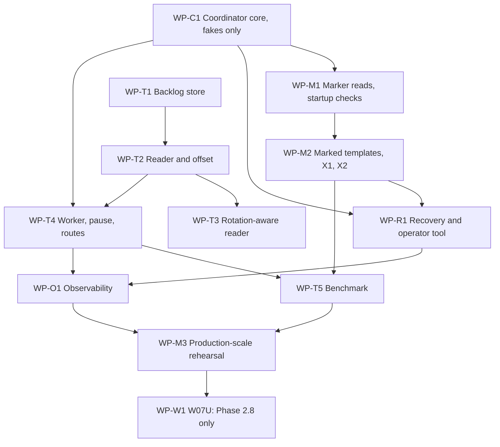

# Implementation work packages

Planning only. **Nothing here is authorized yet.** Backend paths are relative to `isfcr/CYUKTI/backend/`. Test ids `T-n` are in `TEST_AND_ACCEPTANCE_MATRIX.md`.

**Efforts are estimates, not measurements,** in focused engineering days. They assume the pace of earlier phases, and exclude waiting for decisions. Treat them as ±50%.

## Sequence

| Package | Effort | Touches production code? | Needs Neo4j? |
|---|---|---|---|
| **WP-C1** | 5 days | New file. Two guard tests change | **No** |
| WP-M1 | 2 days | Additive in `neo4j_client.py` | Disposable |
| WP-M2 | 3 days | Templates in a new file | Disposable |
| WP-R1 | 4 days | New file. One small ledger change, if OD-12 passes | Disposable, for evidence |
| WP-T1 | 3 days | New file | No |
| WP-T2 | 3 days | **The listener** | No |
| WP-T3 | 3 days | **The listener** | No |
| WP-T4 | 4 days | **The listener,** and `process_alert`'s trace | Disposable |
| WP-T5 | 4 days | None | Disposable |
| WP-O1 | 2 days | Additive | No |
| WP-M3 | 3 days, plus getting the copy | None | **Disposable copy** |
| **Total, up to Phase 2.8** | **About 36 days** | | |
| WP-W1 | 4 days, in Phase 2.8 | **The first writer** | |

**Parallel tracks:** C1 and T1 don't depend on each other.

## Smallest safe milestone

**WP-C1.** The coordinator runs its whole lifecycle against the **real journal and real ledger,** in temporary directories, with a **fake writer and a fake marker reader.** No Neo4j, no listener change, no production writer touched, and nothing imports it at runtime.

It proves ordering, ownership, duplicates, conflicts, and every crash window, before anything can affect production.

---

## WP-C1: Coordinator core

| Item | Detail |
|---|---|
| **Objective** | `submit`, `retry`, `authorize_retry`, `resolve`, `inspect`, `recover`, and the interpretation table, against fakes |
| **New files** | `neo4j_write_coordinator.py`, `tests/test_neo4j_write_coordinator.py`, `tests/test_neo4j_write_coordinator_crash.py` |
| **Changed files** | `tests/test_neo4j_write_journal.py:816` and `tests/test_neo4j_idempotency_ledger.py:1115-1116`: **the "no production module uses it" guards now allow exactly this one module.** A deliberate, reviewed change |
| **New interfaces** | `WriteRequest`, `Disposition`, `CoordinatedResult`, `WriteCoordinator`, `RegisteredOperation`, `OperationRegistry`, the 2.5 error taxonomy, and a `HealthGate` protocol. One test operation only. **No production operation registered** |
| **Dependencies** | D5, D14, D15. Nothing else |
| **Unit tests** | T-1, T-2, T-3, T-20 to T-22 as fakes. Registry rules. Validation. Fingerprint rule. Consistency table with new legal pairs |
| **Fake-driver tests** | Every row of the interpretation table, and every row of the failure table |
| **Failure injection** | `os._exit` at each transition, T-22 |
| **Acceptance** | All failure rows pass. **Zero re-executions in any crash window.** No `Neo4jError` text in any log or store. Backend suite: only intended changes. Mutation check on 10 hand-made faults, all caught |
| **Rollback** | Delete the new files, and revert the two guards. Nothing imports it |
| **Effort** | 5 days |

## WP-M1: Marker reads and startup checks

| Item | Detail |
|---|---|
| **Objective** | `read_applied_write`, `verify_startup`, and constraint verification |
| **Files** | `neo4j_client.py`: additive functions only. `neo4j_write_coordinator.py`. `tests/test_neo4j_marker_reads.py`, and a disposable-server test directory under `research/`, **excluded from normal runs** |
| **New interfaces** | `read_applied_write(key) -> MarkerLookup(status, operation, fingerprint, applied_at)`, `read_marker_schema() -> MarkerSchemaReport`, `StartupReport` |
| **Dependencies** | WP-C1 |
| **Unit and fake-driver** | All four statuses. Deadline on a stalled read. Never retries. No values logged. Every row of the constraint table |
| **Disposable integration** | T-9, T-10, T-11, T-12. Reuses `phase_2_6d_marker_validation/env/` tooling, on new ports |
| **Failure injection** | Server killed during a lookup. Constraint dropped while running: found at gate recovery |
| **Acceptance** | **Marker mode refused in every missing-constraint case.** `UNKNOWN` on every failure. Helper tests still 125 of 125. No write path changed |
| **Rollback** | Remove additive functions |
| **Effort** | 2 days |

## WP-M2: Marked templates, and experiments

| Item | Detail |
|---|---|
| **Objective** | Registered templates with a marker, the CAS, and X1 and X2 |
| **Files** | `neo4j_write_templates.py`, new. Experiment package under `research/design/` |
| **New interfaces** | `duplicate_event.update` template, **registered but with no caller.** `render(op, params)`, `mutation_fingerprint(op, params)` |
| **Dependencies** | WP-M1, and **OD-8** for the CAS |
| **Unit tests** | One marker `CREATE`, after the first `MATCH`. No `SET` on the label. Render is pure. Fingerprint excludes `request_key`, attempt and time |
| **Disposable integration** | T-5, T-6, T-7, T-13, T-14, T-15, T-16 at statement level, T-17, T-18. **E1, E2, E5 rerun on the real templates** |
| **Failure injection** | Kill test: marker and effect always agree. Target missing: no marker. A legacy-style lock holder, for X1 |
| **Acceptance** | 0 marker and effect disagreements. X1 and X2 reported either way. If X1 fails, BL-3's alternative is chosen before moving on |
| **Rollback** | Delete the file. No caller exists |
| **Effort** | 3 days |

## WP-R1: Recovery lifecycle and operator tool

| Item | Detail |
|---|---|
| **Objective** | Recovery, `collect_evidence`, resolve and retry end to end, and a CLI |
| **Files** | `neo4j_write_coordinator.py`. `tools/write_requests.py`, new. `neo4j_idempotency_ledger.py` **only if OD-12 passes** |
| **New interfaces** | `collect_evidence(key) -> Evidence`, `RecoveryResult`, CLI: `list`, `show`, `evidence`, `resolve`, `authorize`, `retry` |
| **Dependencies** | WP-C1, WP-M2 |
| **Unit tests** | Algorithm, new pairs, `CLAIMED_NOT_DISPATCHED`, `RESOLUTION_INCOMPLETE`, each evidence wording. **Recovery can't reach a driver:** a test proves it |
| **Disposable integration** | T-7, T-8, Path A, Path B. Marker found after an ambiguous. Late commit |
| **Failure injection** | Crash in each window from 2.5, using the real stores |
| **Acceptance** | **No code path resolves anything by itself.** Retry needs a named person and reason, recorded in both stores. `FOUND_NOT_COMMITTED` wrongly given: the constraint stops a second effect |
| **Rollback** | Remove the CLI. Stores unchanged, unless OD-12 passed, whose migration has its own plan |
| **Effort** | 4 days |

## WP-T1: Backlog store

| Item | Detail |
|---|---|
| **Objective** | The durable store, standing alone |
| **Files** | `write_backlog.py`, `tests/test_write_backlog.py`, `tests/test_write_backlog_crash.py` |
| **New interfaces** | `WriteBacklog(path)`, `admit_batch(lines) -> AdmitResult`, `claim_next(worker_id)`, `mark_done`, `mark_buffered`, `mark_skipped`, `mark_failed`, `release`, `recover_interrupted`, `stats()`, `check_integrity()` |
| **Dependencies** | OD-1, OD-3, OD-10, OD-11 |
| **Unit tests** | Every state transition, and refusal of others. `UNIQUE(source_key)`. Same key, different content. No identity. Limits. Hash chain or row checksum |
| **Failure injection** | Kill during a batch: all or none, on a real file. Disk full. Damaged file refused and untouched. 0600 |
| **Acceptance** | **Zero acknowledged rows lost across N kills.** X7 reported |
| **Rollback** | Delete. Nothing uses it |
| **Effort** | 3 days |

## WP-T2: Reader and offset

| Item | Detail |
|---|---|
| **Objective** | Durable before the offset moves |
| **Files** | `listener/wazuh_listener.py`, behind a switch, **default off,** so the existing path stays in place. `listener/utils.py`: OD-13's tolerant policy. Tests in `tests/test_listener_backlog.py` |
| **New interfaces** | `BACKLOG_ENABLED`, `BacklogFeeder`. Binary per-line decoding. `rejected_lines` |
| **Dependencies** | WP-T1, OD-5, OD-9, OD-13, **and separate authorization to change the listener** |
| **Unit tests** | Batch and offset order. Rewind safely. UTF-8 failure on one line only. Oversized line. Switch off: **all 80 existing listener tests unchanged** |
| **Integration** | Paced real files, using 2.6C's harness, with a stubbed worker |
| **Failure injection** | Crash before and after a commit, before and after an offset save. T-23 |
| **Acceptance** | **No alert lost in any crash window.** Every repeat refused at the door. Paced 1,000 a second sustained, or the limit reported |
| **Rollback** | Switch off. `offset.dat` format is unchanged |
| **Effort** | 3 days |

## WP-T3: Rotation-aware reader

| Item | Detail |
|---|---|
| **Objective** | Close 2.6C's two rotation gaps |
| **Files** | `listener/wazuh_listener.py`, `tests/test_listener_rotation.py` |
| **New interfaces** | `reader_state.json` (inode, size, last id), `find_rotated_file(last_id)` |
| **Dependencies** | WP-T2, OD-5, X9 |
| **Unit tests** | Larger new file. Appended before rotation. Gzip. Old file missing: alarm and recorded gap. **The two `known_gap` tests are deliberately replaced** |
| **Failure injection** | Rotation with a backlog (T-24). Crash mid-catch-up. Damaged state file: rewind safely |
| **Acceptance** | No alert lost across rotation, in fixtures. **Live confirmation stays open until X9** |
| **Rollback** | Remove sidecar use |
| **Effort** | 3 days |

## WP-T4: Worker, pause, routes

| Item | Detail |
|---|---|
| **Objective** | One worker on the backlog, holding, pausing, and shutting down correctly |
| **Files** | `listener/wazuh_listener.py`. `realtime_socgraph.py`: **only** to set `trace` route before the first write, no logic change. Tests |
| **New interfaces** | `BacklogWorker`, `IngestionGate`, `HealthGate` implementation. `process_alert`'s return value keeps its meaning |
| **Dependencies** | WP-T2, WP-C1, OD-3, OD-4 |
| **Unit tests** | Skipped vs failed, using `trace`. Interrupted states. Thresholds. Pause and resume with hysteresis |
| **Disposable integration** | T-19 outage. Worker holds, with nothing lost, then resumes in order |
| **Failure injection** | T-20 to T-22, T-25, T-26. Exception inside `process_alert`. Neo4j killed in flight |
| **Acceptance** | **Nothing silently acknowledged or discarded in any test.** Order preserved. `DONE_BUFFERED` honest across a crash |
| **Rollback** | Switch off |
| **Effort** | 4 days |

## WP-T5: Benchmark

| Item | Detail |
|---|---|
| **Objective** | Replace the placeholders with measurements |
| **Files** | `research/design/phase_2_7_benchmark/`, new |
| **Dependencies** | WP-M2, WP-T4. X6 and X3 authorized separately |
| **Tests** | B1 to B6 |
| **Acceptance** | Reported with environment, and without estimates mixed in. **OD-2 and D11 can now be decided.** BL-1 and BL-7 closed either way |
| **Rollback** | None needed: nothing changes |
| **Effort** | 4 days |

## WP-O1: Observability

| Item | Detail |
|---|---|
| **Objective** | Every metric and alarm in the throughput document |
| **Files** | `write_backlog.py`, `neo4j_write_coordinator.py`, a read-only status file, a runbook under `research/design/` |
| **New interfaces** | `status()`, watchdog, alarms by log level |
| **Dependencies** | WP-R1, WP-T4 |
| **Tests** | Each threshold fires once, and clears. A stalled worker pages. **No raw key or value in any output:** canary test |
| **Acceptance** | An operator can tell from the status file alone: backlog, age, what's held, and why |
| **Rollback** | Remove |
| **Effort** | 2 days |

## WP-M3: Production-scale rehearsal

| Item | Detail |
|---|---|
| **Objective** | The rehearsal list, X4 |
| **Files** | `research/design/phase_2_7_rehearsal/`, new |
| **Dependencies** | **A production data copy that you authorize.** WP-T5, WP-O1 |
| **Tests** | All rows of the rehearsal table |
| **Acceptance** | Every row passes, or a blocker's raised. BL-5 and BL-6 closed |
| **Rollback** | Remove the copy |
| **Effort** | 3 days, plus the copy |

## WP-W1: W07U integration, scoped for Phase 2.8

**Not part of Phase 2.7, and not authorized.** It's here to show the plan reaches it.

| Item | Detail |
|---|---|
| **Objective** | `_process_unattributed_alert` L206 uses the coordinator, behind a switch, **default off** |
| **Files** | `realtime_socgraph.py`, one call site |
| **Dependencies** | Everything in "Phase 2.8 prerequisites" in the report |
| **Acceptance** | Switch off: **byte-identical behaviour.** Switch on, disposable: 0 double counts, in a kill-under-load run |
| **Rollback** | Switch off. Markers stay |

## Discipline for every package

1. No commit or push without your request.
2. Protected files untouched.
3. Backend suite in an empty network namespace, and only when authorized.
4. A report, with evidence, for each package.
5. Each stops for your review.
