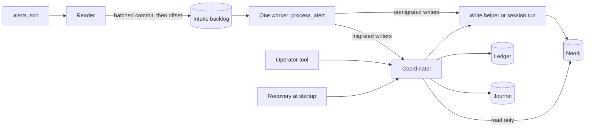
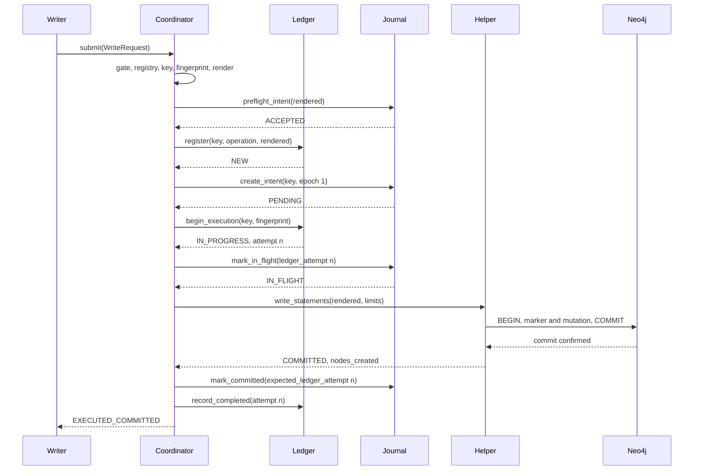

# Phase 2.7 architecture

Planning only. **Nothing here is implemented.** Backend paths are relative to `isfcr/CYUKTI/backend/`.

**Labels:** **[F]** fact from source, tests or Phase 2.6 evidence, **[R]** recommendation, **[H]** hypothesis, **[U]** unverified, needing the experiment named in `OPEN_DECISIONS_AND_BLOCKERS.md`.

## The design in one page

Two new components, and no new source of truth for writes:

1. **Write coordinator:** orders calls across the ledger, journal and helper, and interprets markers. It holds no durable state of its own.
2. **Intake backlog:** a durable SQLite spool between the alert file and `process_alert`. It owns only "has this alert been received, and how far did its processing get".



| Question | Answer |
|---|---|
| Does this request exist, and is the payload the same? | **Ledger** |
| May it run now? | **Ledger,** through `begin_execution` |
| What exactly should be sent? | **Journal** |
| What did the attempt report? | **Journal,** then mirrored to the ledger |
| Was it applied? | **Neo4j,** through the marker |
| Was this alert received, and is it finished? | **Backlog** |
| Was an uncertain outcome committed? | **A named person,** using evidence |

## What's reused

| Component | Reused as it is | Source |
|---|---|---|
| Transaction, timeout and outcome classification | Yes | [F] `neo4j_client.py:_execute_write` L289-360, `neo4j_client.py:_classify_write_failure` L221-241 |
| Limits: 8 s transaction, 5 s retry, 3 s acquisition | Yes | [F] `neo4j_client.py:WriteLimits` L111-176 |
| Intent storage, correlation, epochs, fencing | Yes | [F] `neo4j_write_journal.py:NeoWriteJournal.create_intent` L1129-1170, `neo4j_write_journal.py:NeoWriteJournal.mark_in_flight` L1269-1275 |
| Preflight | Yes, replacing 2.5's proposed `check_statements` | [F] `neo4j_write_journal.py:NeoWriteJournal.preflight_intent` L1172-1231 |
| Identity, claims, attempts, conflicts | Yes | [F] `neo4j_idempotency_ledger.py:IdempotencyLedger.register` L972-1012, `neo4j_idempotency_ledger.py:IdempotencyLedger.begin_execution` L1096-1104 |
| Fingerprint | Yes | [F] `neo4j_idempotency_ledger.py:fingerprint_payload` L320-356 |
| Source identity, request key | Yes | [F] `listener/utils.py:extract_source_identity` L57-85, `listener/utils.py:request_key` L96-102 |

**New:** the coordinator, the backlog, an operator tool, and two read functions in `neo4j_client.py`.

## Request lifecycle

Numbers match your brief's list. Exact failure behaviour is in `COORDINATOR_STATE_MACHINE.md`.

| # | Step | What happens | Source of the behaviour |
|---|---|---|---|
| 1 | Admission | The caller gives a `WriteRequest`. Refused at once if the health gate is open, or marker mode isn't verified | New |
| 2 | Validation | The operation must be in the registry, with a usable source key | New |
| 3 | Key and fingerprint | `request_key(source_key, operation)`. **Mutation fingerprint:** `fingerprint_payload` over the statements **without the marker** | [F] E9 did this. New here as a rule |
| 3b | Render | The registered template adds the marker, with `request_key`, `operation` and `fingerprint` as parameters. Deterministic, so **the rendered statements are a pure function of the request** | New |
| 3c | Preflight | `preflight_intent` on the rendered statements. Refusal means nothing is registered | [F] Journal |
| 4 | Ledger registration | `register` over the rendered statements. `NEW` continues. `DUPLICATE` follows the table. Conflict raises | [F] Ledger |
| 5 | Journal intent | `create_intent(correlation_key=key, epoch=1)`, or finds the existing one | [F] Journal |
| 6 | Claim, then in-flight | `begin_execution` returns the attempt. `mark_in_flight(ledger_attempt=attempt)` | [F] Settled in 2.6B: the ledger assigns the attempt |
| 7 | Execution | `write_statements` with explicit `WriteLimits` | [F] Helper |
| 8 | Atomic marker | The marker is created inside the mutation's first `MATCH`, in one statement and transaction | [F] E1, E2, kill test |
| 9 | Interpretation | The table in the state machine document. **`nodes_created` and the marker lookup both matter** | [F] E1, E5 |
| 10 | Finalization | Journal first, then ledger, each with the attempt | [F] 2.5's ordering rule |
| 11 | Ambiguity | Journal `AMBIGUOUS`, ledger `UNCERTAIN`. A marker read is **attached as evidence, and resolves nothing** | Your safeguard 10 |
| 12 | Recovery and retry | **Path A:** `NOT_COMMITTED` reuses the record through journal `authorize_retry`. **Path B:** `FOUND_NOT_COMMITTED` makes the next epoch, with `authorized_by` and `reason` | Settled in 2.6B |
| 13 | Duplicates and conflicts | By ledger state, and marker fingerprint | `COORDINATOR_STATE_MACHINE.md` |

## Sequence: first execution



## Responsibility matrix

| Duty | Writer | Coordinator | Ledger | Journal | Helper | Neo4j | Backlog | Operator |
|---|---|---|---|---|---|---|---|---|
| State the operation and payload | **Does** | | | | | | | |
| Build the key and render the statement | | **Does** | Checks the key | Checks the key | | | | |
| Admit or refuse by payload | | Orders | **Decides** | Refuses unstorable | | | | |
| Grant the right to run | | Asks | **Decides** | | | | | |
| Store the exact payload | | | | **Does** | | | | |
| Assign attempts | | Passes on | **Does** | Stores, fences | | | | |
| Run one transaction, classify the outcome | | Calls | | | **Does** | | | |
| Guarantee one marker per key | | Verifies at start | | | | **Does** | | |
| Reconcile the two stores | | **Does** | | | | | | |
| Resolve uncertainty, authorize retries | | Carries out | Records | Records | | | | **Decides** |
| Hold alerts through outages | | Signals | | | | | **Does** | |
| Retry on its own | **Never** | **Never** | | | Only before COMMIT | | | |

## Coordinator interface

```python
@dataclass(frozen=True)
class WriteRequest:
    source_key: str            # alert["source_identity"]["source_key"]
    operation: str             # from the registry
    parameters: Mapping        # the mutation's parameters, no marker fields

class Disposition(Enum):
    EXECUTED_COMMITTED; COMMITTED_NO_EFFECT; EXECUTED_NOT_COMMITTED; EXECUTED_UNCERTAIN; COMMITTED_UNRECORDED
    ALREADY_COMPLETED; ALREADY_APPLIED; IN_PROGRESS_ELSEWHERE; AWAITING_AUTHORIZATION
    BLOCKED_UNCERTAIN; BLOCKED_ABANDONED; NOT_DISPATCHED_UNAVAILABLE; MARKER_CONFLICT

class WriteCoordinator:
    def __init__(self, journal, ledger, *, writer, marker_reader, registry, limits, health): ...
    def verify_startup(self) -> StartupReport                      # refuses marker mode without the constraint
    def submit(self, request) -> CoordinatedResult
    def retry(self, key, *, worker_id=None) -> CoordinatedResult
    def authorize_retry(self, key, *, principal, reason) -> RequestView    # ledger only
    def resolve(self, key, *, decision, principal, reason, evidence) -> RequestView
    def collect_evidence(self, key) -> Evidence                    # read only, and needs Neo4j
    def recover(self) -> RecoveryResult                            # never calls Neo4j
    def inspect(self, key) -> RequestView
```

[F] `writer` and `marker_reader` are injected so core tests need no driver, as 2.5 proposed. **Taking statements out of `WriteRequest` and using a registered template** is a change from 2.5, so a caller can't omit the marker. Only `retry` uses stored statements.

## What the caller sees

| Disposition | Ran here? | Effect in the graph | Caller should |
|---|---|---|---|
| `EXECUTED_COMMITTED` | Yes | Applied | Continue |
| `COMMITTED_NO_EFFECT` | Yes | **None: target missing** | Log an error. Counted. Retrying can't help |
| `EXECUTED_NOT_COMMITTED` | Yes | Not applied | Continue. It's held for authorization |
| `EXECUTED_UNCERTAIN` | Yes | **Unknown** | Continue. It's held for a person |
| `COMMITTED_UNRECORDED` | Yes | Applied, journal not updated | Alarm. Recovery makes it uncertain |
| `ALREADY_COMPLETED` | No | Applied earlier, by the ledger's record | Continue |
| `ALREADY_APPLIED` | Refused by the constraint | Applied earlier, **by the marker, fingerprint matching** | Continue |
| `IN_PROGRESS_ELSEWHERE` | No | Unknown | Continue |
| `AWAITING_AUTHORIZATION` | No | Not applied | Continue |
| `BLOCKED_UNCERTAIN`, `BLOCKED_ABANDONED` | No | Unknown or given up | Continue |
| `NOT_DISPATCHED_UNAVAILABLE` | **No,** nothing registered or claimed past the failure | None | **Hold the alert: `THROUGHPUT_AND_BACKPRESSURE_DESIGN.md`** |
| `MARKER_CONFLICT` | Refused | **Another payload applied under this key** | Alarm. A person looks |

**A raised error** means a programming fault or damaged store, listed in 2.5's taxonomy, and it's never a claim about Neo4j.

**[F] A trap in the caller's path:** `realtime_socgraph.py:process_alert` L289-833 catches every `Exception` and returns `False` (L829-833), and it also returns `False` for skipped alerts. So **`process_alert`'s return value can't tell a skipped alert from a failed one.** The backlog worker must use the `trace` argument, whose `path` is set for each deliberate route.

## Facts that differ between documents and code

| # | Document | Says | Code or evidence |
|---|---|---|---|
| 1 | 2.5 interface | `check_statements` for preflight | [F] Implemented as `preflight_intent`, a method |
| 2 | 2.5 and 2.6A | Marker holds `attempt`; earlier forms lacked fingerprint | Superseded by your accepted `{request_key, applied_at, operation, fingerprint}` |
| 3 | 2.5 | "No journal or ledger user yet" tests | [F] `tests/test_neo4j_write_journal.py` L816 and `tests/test_neo4j_idempotency_ledger.py` L1115-1116 **will fail by design when the coordinator imports them.** WP-C1 updates them deliberately |
| 4 | 2.6A | Production constraints unknown | [F] 2.6E: ten exist |
| 5 | 2.6C | 0.78% more alerts | [F] 2.6E: up to 11.8%, and 96.8% on one day |
| 6 | 2.6C | Sustains 377 a second | [F] True of the run. **2.6E shows 377 isn't the peak** |
| 7 | `config.py` | `ALERT_FILE` from `WAZUH_ALERT_FILE` (L10) | [F] The listener hard-codes its own at `listener/wazuh_listener.py` L26. The setting has no effect there |
| 8 | Campaign contract | Cites listener lines such as L272-288 | [F] Those lines moved in 2.6C. The behaviour, offset advancing at queue time, is unchanged |
| 9 | Campaign contract CA-D7-O | Three options for the offset boundary | [R] This design adds a fourth: after the durable spool |
| 10 | `listener/utils.py` | Imported as `from utils import` | [F] Only works with `listener/` on `sys.path`. The coordinator needs `from listener.utils import request_key`, [U] to confirm in WP-C1 |
| 11 | 2.5 and early drafts of this plan | A person can abandon any held request | [F] The ledger reaches `ABANDONED` only from `UNCERTAIN`, at `neo4j_idempotency_ledger.py` L142-152. **OD-12** |

## Scope limits

- [F] It protects individual writes. **It doesn't make `process_alert` atomic.** Up to 13 writes per alert stay separate requests.
- It offers **no exactly-once guarantee.** SQLite and Neo4j can't commit together.
- It doesn't cover MISP, Shuffle, or in-memory campaign caches.
- [F] All 12 campaign activity decisions remain open. **The coordinator preserves each writer's current semantics,** and changes none of them.
