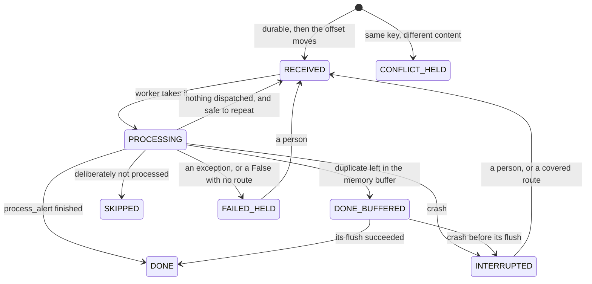

# Throughput and backpressure design

Planning only. **Nothing here is implemented.** Backend paths are relative to `isfcr/CYUKTI/backend/`. **[F]** fact, **[M]** model output, **[R]** recommendation, **[H]** hypothesis, **[U]** unverified.

**Numbering:** `Dn` is the coordination register in `phase_2_6a_decisions/DECISION_REGISTER_D1_D15.md`. `CA-Dn` is the separate campaign-activity list in `campaign_activity_contract/OPEN_POLICY_DECISIONS_FINAL.md`. Those two lists reuse the same numbers. "Worst day" here means the largest by volume, 20 April, not the old key's worst day, 26 September.

## Recommendation

**[R] Approach A: a bounded durable backlog, with one worker and controlled ingestion.** Batched Neo4j writes (B) stay as a later, measured optimization for duplicate updates only.

**The reason in one sentence:** the traffic is rare, extreme bursts rather than sustained load, so what's needed is somewhere safe to absorb a burst and time to drain it, and batching doesn't provide that.

**What it can't promise yet:** a drain rate, because `process_alert`'s real latency has never been measured. The figures below that depend on it are targets, to be set by the benchmark.

## Evidence, and its limits

| Fact | Value | Source |
|---|---|---|
| Alerts, nine months | 681,259 | 2.6E |
| Busiest **event-time** second | 11,566. **Not a confirmed arrival rate** | 2.6E |
| Seconds with 100 or more | 2,087 | 2.6E |
| Daily volume: median file | **198 alerts** | `evidence/backlog_model_output.txt` |
| 90th percentile file | 2,117 | The same |
| Largest day | 379,908, **a mean of 4.40 a second** | The same |
| Next largest day | 107,461, a mean of 1.24 a second | The same |
| Alert size | Median 893, p99 4,233, max 9,216 bytes, mean 1,109 | The same, sample only |
| Listener with a stub worker | About 1,360 to 1,780 a second | 2.6C |
| Journal, one correlated life | 9.2 ms median | 2.6B |
| Marked write, on the disposable server | 6.5 to 7.0 ms median | 2.6D |
| Ledger cost on this path | **Unmeasured** | |
| `process_alert` | **Unmeasured** | |
| Real arrival rate | **Unmeasured** | |

[F] **The gap between the daily mean and the burst is the whole design problem:** mean 4.4 a second on the worst day, and 11,566 in one event-time second.

### What the current path can't do

[F] `listener/wazuh_listener.py:AlertFileHandler.read_new_lines` L279-360 saves the offset once an alert is in a **1,000-entry memory queue.** So a crash loses up to 1,000 accepted alerts. At the peak figure, that queue holds well under a second.

## The backlog model

**[M] One day, second by second, with event time standing in for arrival time.** That's an assumption, and it's the only day available without reading production again. Produced by `evidence/backlog_model.py`.

| Drain rate | Largest backlog | Seconds to empty after it | Seconds with any backlog |
|---|---|---|---|
| 5/s | 6,836 | 1,589 | 1,662 |
| 10/s | 6,616 | 757 | 820 |
| 20/s | 6,183 | 312 | 401 |
| 50/s | 4,893 | 99 | 156 |
| 100/s | 2,781 | 30 | 76 |
| 200/s | 984 | 8 | 30 |
| 400/s | 9 | 1 | 1 |

**On this day, even 5 a second clears within about half an hour.** The busiest day is about 42 times its volume, so this table doesn't bound it. [U] X6 reruns this model over the archive's per-second counts, which needs your authorization to read those files again.

**[H] A worst-case bound:** at 20 a second, 379,908 alerts drain in about 5.3 hours.

## Approach comparison

| Criterion | **A. Bounded durable backlog** | B. Batched Neo4j writes |
|---|---|---|
| **Data-loss risk** | **Low.** An alert is durable before the offset moves. It closes the 1,000-alert crash gap | **Unchanged by itself.** Batching changes writes, and intake keeps its memory queue. It needs A's intake anyway |
| **Ordering** | **File order,** one worker | In batch order, if batches are serial. **Within one batch, the query's row order governs: an additive count is fine, and `last_technique`-style fields aren't** |
| **Duplicates** | `UNIQUE(source_key)` stops re-read alerts at the door, and per-request keys beneath | One marker per alert in a batch means a repeat in the batch **fails the whole batch.** Per-batch marker means re-delivery isn't caught: [F] D8's problem |
| **Recovery** | Simple states, per alert | **An ambiguous batch makes many requests uncertain at once,** all for a person |
| **Memory and disk** | Disk: about 421 MB of text for the worst day, plus overhead. Memory: small | Memory: batches. Disk: journal holds each batch's whole payload |
| **Neo4j contention** | **One write at a time** from this path | Longer transactions hold more locks, and an 8 s limit becomes tighter as a batch grows |
| **Implementation** | New spool and reader changes. **No change to `process_alert`'s logic** | **Rewrites writers** and needs a D8 decision, on top of A's intake |
| **Throughput** | Limited by the slowest alert's cost | [H] Could be much higher for duplicates. **Not measured.** Not automatically faster: a failed batch retries everything |

**Where B may earn its place:** [F] 84% of the sample's alerts (7,552 of 9,015) are unattributed duplicates. [H] **If the large bursts have the same mix, they're dominated by updates to a few events,** which is where batching helps. [U] That mix hasn't been measured on those days. [R] Consider it once measured, for W07 and W08 only, with D8 decided.

## The backlog

### What it is

`backend/write_backlog.py`, one SQLite file, the journal's durability settings: WAL, `synchronous=FULL`, mode 0600, integrity by row checksum.

| Column | Purpose |
|---|---|
| `seq` | File-order position. Autoincrement |
| `source_key` | `wazuh:<manager>/<id>`, or null with no identity. **`UNIQUE` where not null** |
| `content_sha256` | Of the raw line |
| `raw_line` | The alert, **dropped once finished** |
| `state` | Below |
| `received_at`, `finished_at` | For age and latency |
| `identity_status`, `route` | From the listener, and the route once known |
| `detail` | Type and code only, no values |

**It isn't a second source of truth for writes.** It knows only whether an alert was received and how far processing got. Whether anything was written is the ledger's, journal's and marker's business.

### States

**Why a crash doesn't simply re-run:** [F] most writers aren't idempotent, so re-running a half-processed alert could double-count. **So until a route is fully covered by the coordinator, an interrupted alert is held and visible.** That's never a silent loss, and never a silent repeat. **Decision OD-3.**

**`DONE_BUFFERED` keeps an honest record of campaign decision CA-D7.** [F] An attributed duplicate goes to `DuplicateBuffer`, which is memory only. So "finished" isn't yet "persisted" for those, until W08 is migrated.

### How it closes known gaps

| Gap, from 2.6C | Effect of the backlog |
|---|---|
| **1. Crash with up to 1,000 alerts in memory** | **Closed.** Durable before the offset moves |
| **Redelivery after a restart** | **Closed for alerts with identity.** Re-read lines hit `UNIQUE(source_key)`, and are counted as duplicates |
| **D13: a creator re-delivered as a duplicate** | **Closed for redelivery from the reader:** `MARKER_AND_RECOVERY_DESIGN.md` |
| **Identity conflicts not observable** | **Closed.** Same key, different content: `CONFLICT_HELD` and an alarm, rather than a silent drop |
| **5. Unusable offset file** | **Made safe.** Rewinding is no longer dangerous, so the reader can rewind rather than skip. Duplicates are refused at the door |
| 2 and 3. Rotation | Needs the reader changes below |
| 4. Invalid UTF-8 | Needs binary reading below |

**[F] `seen_alerts` is then redundant** for alerts with identity, and removing it removes the 550 to 580 µs scan per alert.

## Admission

| Parameter | Value | Basis |
|---|---|---|
| Reader batches | Up to 500 lines, or 200 ms, per SQLite commit | [H] One fsync is about 3 ms (2.6B create), so batching is what makes admission cheap. X7 measures it |
| **Offset** | **Saved after the batch commits,** with the existing atomic save | CA-D7-O, a new option. **OD-1** |
| Admission rate | [H] Thousands a second, limited by parsing. **Not guaranteed.** The file holds anything not yet read | X7 |
| Per-alert INFO logging | [R] Lower to DEBUG in the reader, with counters instead. [F] It costs about a third of reader time | 2.6C. It changes what operators see: **OD-9** |

## Processing

| Parameter | Value | Why |
|---|---|---|
| **Concurrency** | **One worker** | [F] Campaign ordering depends on it, and there's no per-campaign partitioning. Parallel workers are a separate design |
| **Memory queue** | Removed. The worker reads from the backlog in `seq` order | |
| Maintenance, flush threads | Unchanged | |

## Capacity and thresholds

**These are proposals.** All except the disk figures need X5 and X6.

| Limit | Value | Reason |
|---|---|---|
| **Maximum backlog, count** | 1,000,000 pending rows | [M] About 2.6 times the worst day |
| **Maximum backlog, bytes** | 2 GiB of `raw_line` | [M] The worst day is about 421 MB of text, and the whole archive about 755 MB, before overhead |
| **Minimum free disk** | 5 GiB on the backlog's filesystem | Leaves room for the journal, ledger and Wazuh |
| **Drain-rate target** | **At least 50 a second,** sustained, measured end to end | [H] About 11 times the worst day's mean. Clears that day's full volume in about 2.1 hours |
| **Maximum tolerated age** | **30 minutes for the oldest pending alert, to page someone** | **Your decision: OD-2.** A backlog delays detection |

### If 50 a second can't be met

[H] Illustrative only: 7 ms marked write, 9.2 ms journal, a similar ledger cost, plus the rest of `process_alert`, is about **20 to 40 a second through one worker, if every alert were coordinated.** That's below the target, and that's why the benchmark comes before any commitment.

| Choice | Cost |
|---|---|
| Accept longer drains | Detection delay in bursts |
| Batch duplicates (B) | Needs D8, and recovery of batches |
| Coordinate only Tier 1 (D11) | Convergent writers stay unprotected |
| Group commit inside the journal and ledger | Changes completed components |

### Thresholds and what they do

| Signal | Warn | Page | Pause ingestion | Resume |
|---|---|---|---|---|
| Pending rows | 100,000 | 500,000 | **950,000** | 700,000 |
| `raw_line` bytes | 500 MiB | 1 GiB | **1.9 GiB** | 1.4 GiB |
| Free disk | 20 GiB | 10 GiB | **5 GiB** | 8 GiB |
| Oldest pending age | 5 min | 30 min | **No pause:** ingesting doesn't worsen it | |
| Time to next rotation, with reader behind | | Under 1 hour | | |

**Ingestion pauses only when the backlog can't safely take more.** While paused, the offset stays where it is, and **alerts stay safely in Wazuh's own file.**

### When ingestion must pause

1. A backlog limit is reached.
2. The backlog's store refuses a write.
3. Integrity checks fail.
4. An operator asks for it.

**It doesn't pause because Neo4j, the journal or the ledger is down.** That's what the backlog is for: reading continues, and the worker holds.

## When a dependency is unavailable

| Unavailable | Coordinator | Worker | Reader | Alert |
|---|---|---|---|---|
| **Neo4j** | [R] Health gate opens after 3 consecutive connection failures, and a read probes every 5 s | **Holds,** taking nothing new | Continues | Stays `RECEIVED` |
| **Ledger** | `NOT_DISPATCHED_UNAVAILABLE` | Holds, retrying with backoff up to 30 s | Continues | Returns to `RECEIVED` **only if nothing was dispatched for this alert** |
| **Journal** | The same. [F] Your Phase 2.3 rule: a journal failure never acknowledges or discards | Holds | Continues | The same |
| **Backlog** | | Stops | **Pauses** | In Wazuh's file |
| **Disk full** | Stores refuse | Holds | Pauses | In Wazuh's file |
| **Marker constraint missing** | Marker mode refused at start | Migrated routes hold, or the switch is off | Continues | `RECEIVED` |

**This is D15 made concrete,** extending the 2.6A recommendation: there the reader stopped once the memory queue filled, and here it keeps reading into the backlog. **Unmigrated writers** have no such gate: [F] they swallow failures in `process_alert` today. So an outage during which unmigrated writers run still loses their effects. The gate can hold the whole worker to prevent that, **which is the recommended default,** and it's stronger than today's behaviour. **OD-4.**

## Rotation

[F] 2.6E counted 110 rotations in nine months, with archives at `/var/ossec/logs/alerts/YYYY/Mon/ossec-alerts-DD.json`, sometimes `.gz`.

**[R] A rotation-aware reader,** in `listener/wazuh_listener.py`:

| Requirement | Design |
|---|---|
| Know which file the offset belongs to | Add `reader_state.json`: inode, size and last read id. **`offset.dat` stays, unchanged in format, for rollback** |
| Detect rotation | The inode changed, or the size shrank |
| Finish the old file | Read the rest from the rotated path, for the date of the last id. Gzip supported |
| **If the old file can't be found** | **Alarm, and record the gap.** Never assume nothing was lost |
| Rewind safely | Duplicates are refused by `UNIQUE(source_key)` |
| Alerts without identity on rewind | **Would be delivered again.** [F] 0 of 681,259 in the archive lack identity |

**[F] This changes a format decision from 2.6C,** which reported the gap rather than changing it. Hence **OD-5.** [U] Whether rotated files appear before the live file's replacement, and permissions in production, need X9.

**Invalid UTF-8:** [R] read in binary, and decode each line. A line that fails is counted, logged by position, and passed over, **and its bytes are preserved** in a `rejected_lines` table, so nothing's silently lost. [F] 0 in the archive.

## Shutdown and restart

| Event | Behaviour |
|---|---|
| **Clean shutdown** | Reader stops. Worker finishes its current alert, up to the helper's limits. Buffer flush as today. `RECEIVED` rows stay for next time |
| **In-flight transaction at shutdown** | **Waits for its outcome.** If the limit passes, it stays `IN_FLIGHT`, and recovery makes it uncertain. Never assumed either way |
| **Restart** | Integrity checks, `recover()`, `PROCESSING` becomes `INTERRUPTED`, `verify_startup()`, then reader and worker start |
| **Crash** | The same. `DONE_BUFFERED` rows since the last confirmed flush become `INTERRUPTED`: that's **CA-D7's loss, now visible** |

## Event time under backlog

[F] Campaign decision CA-D9 flags a hypothesis: `processing_time_fallback` uses processing time for an alert with no timestamp, **and a backlog widens that gap.** A late-processed alert could mis-expire campaigns through the watermark. [F] 0 such alerts in the archive, with every timestamp well formed. So the risk looks small, and **CA-D9 stays open.**

[F] Replaying in order preserves event-time decisions, since the listener's lifecycle runs on event time. **[U] Maintenance sleeping 5 s on the wall clock, during a long drain,** needs the benchmark.

## Monitoring

| Metric | Source |
|---|---|
| Rows by state, oldest pending age, bytes, free disk | Backlog |
| Admission rate, drain rate, reader lag in bytes | Reader, worker |
| Dispositions by operation | Coordinator |
| Requests `UNCERTAIN`, `NOT_COMPLETED`, conflicts | Ledger |
| Journal and ledger commit latency | Coordinator |
| Health gate state, time open | Coordinator |
| Worker heartbeat age | Watchdog |
| `identity_unavailable`, `unreadable_lines`, `CONFLICT_HELD` | Listener |
| Open transactions, longest | `SHOW TRANSACTIONS`, read only |

[F] Today's dashboards read `logs/prerana_listener.log`. [R] Expose these through a small read-only status file first. A dashboard panel can follow.

## The benchmark

**Run on a disposable Neo4j, at production scale where possible, with no production contact.** It defines the design's real numbers.

| ID | Measures | Method | Output |
|---|---|---|---|
| **B1** | **`process_alert` latency, by route** | Replay the 9,015-alert sample, then a copy of the worst day, through the real function on a disposable graph, with MISP and Shuffle stubbed | Median, p95, p99, max by `trace.path` |
| **B2** | Coordinator overhead | The same, with a test-only coordinated writer | Added per request: ledger, journal, marker |
| **B3** | **Sustained arrival rate** | Paced writer at 50, 100, 500, 1,000 and 5,000 a second, real reader into a real backlog | Admission limit, and at what point the reader lags |
| **B4** | **Backlog growth and drain** | Replay real bursts at event-time speed, then at 10 times | Largest backlog, drain rate, age, over time |
| **B5** | Recovery | Kill at load, restart | Time to resume, rows held, nothing lost |
| **B6** | Sizing | Disk per alert, in practice | Bytes per row, growth per day |
| **X6** | **Real burst shape** | Per-second counts from the archive, read only. **Needs your authorization** | The model above, over all nine months |

**Pass criteria are set after B1:** a real drain rate, then OD-2's tolerated age, decide whether A alone is enough.

## Trade-offs, stated plainly

| Accepted | Why |
|---|---|
| Detection is delayed during a burst, not lost | A delay can be seen and bounded. A loss can't |
| Interrupted alerts wait for a person at first | Safer than double counting, until routes are covered |
| A third SQLite file | The alternative is keeping alerts in memory |
| One worker | Preserves ordering. Throughput comes second |
